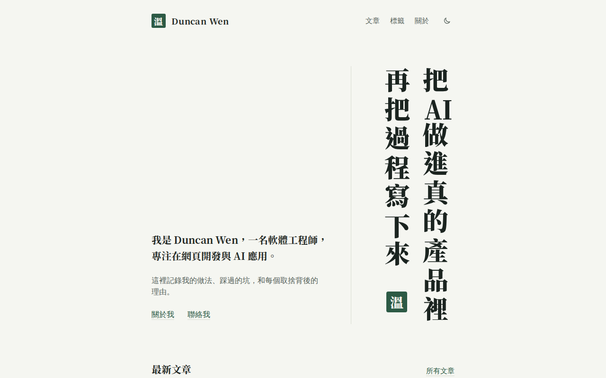
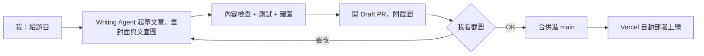
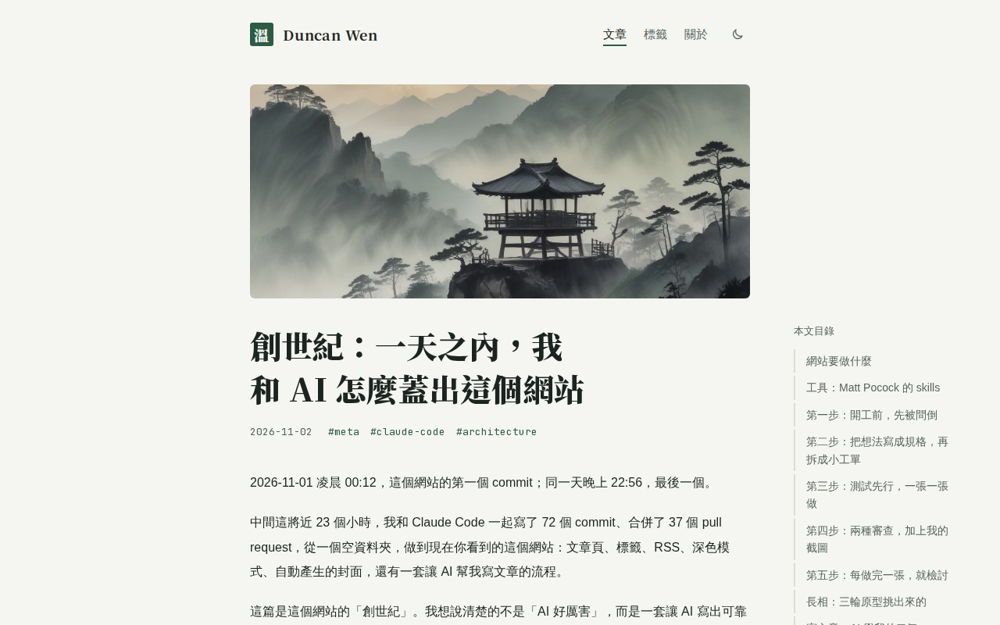

# dwen-cms

用 AI agent 協作經營的個人技術品牌網站：我定規則與審核，agent 實作與起草，每個變更都經過測試與 PR 審核才上線。

**網站：<https://duncan-wen.aibbm.org/>**

第一版在一天內，從空資料夾做到上線。



## 亮點：AI agent 協作的內容流程

網站沒有後台。每篇文章是 repo 裡的一個 MDX 檔案；**草稿就是還沒合併的 PR，合併的那一刻就是發布**。AI agent 負責起草、檢查、開 PR，但只有我能決定什麼東西上線。



agent 不能隨便寫，它寫的草稿必須通過網站自己的內容規則：

- **標籤**只能用核准清單裡的，新標籤要在 PR 裡寫明理由。
- **改網址**會記下舊網址，自動永久轉址，舊連結不會失效。
- **移除**的文章回應 410（已移除），而不是 404，網址也不能再給新文章用。
- **勘誤**和**改版**分開處理：改錯字讀者看不出來；改了讀者會學到的內容，就要顯示「更新於」和說明。
- agent 查不到的個人細節（花了多久、當時的感受）不會自己編，而是列在 PR 裡請我確認。

## 我和 AI 的分工

這個 repo 大部分的程式碼和文字是 AI 寫的。我的工作是設計它工作的規則，並對每一個上線的東西負責。

| 我（Owner） | AI agent（Claude Code） |
|---|---|
| 定目標和讀者、在訪談中做每個決策 | 追問需求、整理成詞彙表和 ADR |
| 決定詞彙表、ADR、程式碼規範與 skills 這些規則 | 寫規格、拆工單、測試先行實作 |
| 看截圖決定上不上線，只有我能發布 | 起草文章、開 Draft PR、跑檢查、合併 |
| 每輪檢討後調整 agent 的工作環境 | 程式審查、提出改善建議 |

規則都寫在 repo 裡，agent 每次工作都照著做：

- [`GLOSSARY.md`](GLOSSARY.md)：領域詞彙表。從程式碼、測試到網站上的文字，都用同一套詞。
- [`docs/adr/`](docs/adr/)：架構決策紀錄。寫明當時考慮過哪些替代方案，以及為什麼沒選。
- [`CODING_STANDARDS.md`](CODING_STANDARDS.md)：程式審查依據的規範。
- [`.claude/skills/write-post/`](.claude/skills/write-post/)：寫文章的 skill，包含三種文風和完整步驟。
- [`docs/owner-guide.md`](docs/owner-guide.md)：Owner 操作手冊。

## 工程紀律

- **每個變更都走 PR**，CI 通過才合併。可以看 [合併過的 PR](https://github.com/duncan-wen/dwen-cms/pulls?q=is%3Apr+is%3Amerged)。
- **pre-commit** 跑 `pnpm check`：lint、型別檢查、內容檢查、單元測試。
- **CI** 另外用真實內容建置（有警告就算失敗），再用 Playwright 跑 smoke test。
- **測試先行**：功能從一個會失敗的測試開始，一次做一小段。
- **截圖審核**：每頁都拍亮色、深色、桌機、手機四種截圖，頁面出現橫向捲動或內容被裁掉，就會失敗。



## 技術棧

- **框架**：Next.js 16（App Router）、React 19、TypeScript
- **內容**：MDX（`@mdx-js/mdx`）、Shiki 程式碼高亮、Mermaid 圖表、RSS（`feed`）
- **樣式**：Tailwind CSS 4、`next-themes` 深色模式
- **測試**：Vitest、Playwright
- **部署**：Vercel、Vercel Analytics
- **AI**：Claude Code，工作方法參考 Matt Pocock 開源的 [skills](https://github.com/mattpocock/skills)；封面用 Fooocus（SDXL）在本機產生

## 延伸閱讀

- [創世紀：一天之內，我和 AI 怎麼蓋出這個網站](https://duncan-wen.aibbm.org/posts/how-this-site-was-built)：從訪談、規格、工單到檢討，完整的建構過程
- [為什麼這個網站的文章寫在 git 裡](https://duncan-wen.aibbm.org/posts/why-mdx-in-git)
- 架構決策紀錄：
  - [0001 內容用 MDX 放在 git，不用 hosted CMS](docs/adr/0001-mdx-in-git-over-hosted-cms.md)
  - [0002 Next.js 部署在 Vercel，不用 Astro](docs/adr/0002-nextjs-on-vercel.md)
  - [0003 內容規則自己寫，通用功能用現成套件，不用部落格範本](docs/adr/0003-own-content-rules-borrow-commodity-features.md)
  - [0004 封面在本機用 Fooocus 產生](docs/adr/0004-covers-drawn-locally-with-fooocus.md)

## 本機開發

需要 Node.js 22 以上和 pnpm。

```bash
pnpm install
pnpm dev      # 開發伺服器
pnpm check    # lint + 型別 + 內容檢查 + 測試
pnpm smoke    # 建置測試內容並跑 Playwright smoke test
```

## 授權

- 程式碼以 [MIT](LICENSE) 授權。
- `content/` 裡的文章、圖片和封面，著作權歸 Duncan Wen 所有，保留一切權利，未經同意不得轉載或再利用。
