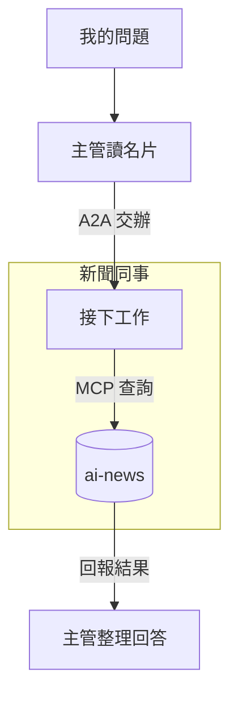

我讓兩個 AI agent 交換了一張名片，它們就開始分工合作了……然後在第一份報告裡，一起傳錯了話。

一個是「新聞同事」，會找 AI 新聞；一個是「主管」，負責回答我的問題。我問主管「最近有什麼 A2A 的新聞」，它看了同事的名片，就把工作交了出去。同事交回 3 則新聞，其中 2 則根本不相關，主管卻照抄，跑 3 次有 2 次跟我說：「A2A 發布了新版本 v0.33.0」。這個版本並不存在。

讓 AI 之間交換名片、互相派工作的這套規則，就叫 A2A（Agent-to-Agent）。這篇先用白話講它是什麼，再拆我做的這兩個 agent，最後回頭看那份傳錯的報告：多找一個 AI 合作，就多一個傳錯話的地方。

## MCP 是手跟腳，A2A 是同事

一句話分清楚：

- **MCP（Model Context Protocol）** 讓 AI 用**自己的**工具，像大腦配上手跟腳。工具叫一下動一下，不會有自己的意見。
- **A2A** 讓 AI 找**別人的** AI 幫忙，像打電話請另一家公司的專員處理一件事。你只說要什麼，對方怎麼做、用什麼工具，你不用知道。

起因是 AWS 的一篇文章：〈[Build composable, interoperable multi-agent systems with A2A on AWS](https://aws.amazon.com/blogs/machine-learning/build-composable-interoperable-multi-agent-systems-with-a2a-on-aws/)〉。它示範一家公司的 AI，把「幫我檢查雲端設定安不安全」交給另一家廠商的 AI。兩邊用不同的工具寫成，彼此看不到對方內部，也不用交換密碼，工作照樣交得過去。

兩者也不是二選一。廠商的 AI 對內可以用 MCP 接自己的檢查工具，對外用 A2A 接案子；內部怎麼換，客戶都不用跟著改。

還有一個差別：同事會反問你。廠商的 AI 開始檢查之前，會回頭問委託的公司：「哪幾台是正式上線的機器？」因為這件事只有對方知道。工具不會這樣，它只等你叫它。

A2A 現在是 Linux Foundation 底下的開源專案，AWS 是支持它的組織之一。

## 名片：Agent Card

同事之間要合作，第一步是知道對方會做什麼。A2A 的答案是一張名片，叫 Agent Card：一份 JSON 文件，固定放在 agent 網址底下的 `/.well-known/agent-card.json`，寫著它叫什麼、會哪些技能（skills）、怎麼聯絡它。

另一個 agent 只要讀這一份文件，不用看說明文件、不用裝對方的 SDK、也不用開會，就知道能把什麼工作交出去。AWS 範例裡，委託的那家公司的 AI 一啟動就先讀名片，再自己判斷哪些問題要交出去，所以程式裡沒有半行「這種問題轉給誰」的規則。

名片上寫什麼，也是一個設計決定。廠商的 AI 內部有好幾個工具，名片上卻只寫一個整理過的技能：**名片說的是「我能幫你做什麼」，不是「我是怎麼做的」**。內部換框架、換模型，只要名片和 A2A 的介面不變，對方就不用跟著改。

## 實驗：把我的新聞工具變成同事

讀到這裡，我想起自己手上剛好有一個現成的「手跟腳」：我做的 AI 新聞工具 [ai-news-mcp](https://github.com/duncan-wen/ai-news-mcp)，它是一個 MCP server，平常讓 Claude 查新聞用（做法寫在〈[一個 AI 新聞工具，卻刻意不讓 AI 碰資料](/posts/ai-news-mcp-server)〉）。

那就把它包成一個同事：對外用 A2A 發名片，對內照樣用 MCP 呼叫它。再寫一個主管，讀名片、決定要不要找它幫忙。不用 AWS、不用兩個帳號，兩支 Python 程式在同一台電腦上跑。



用的是 A2A 官方的 Python SDK `a2a-sdk`（這次是 1.3.1 版），實作的是 A2A 規格 1.0。先裝好需要的套件：

```bash
pip install "a2a-sdk[http-server]" uvicorn httpx mcp openai
```

### 新聞同事：名片寫一套，背後做一套

第一支程式是新聞同事。上半段是名片：一個技能「找 AI 新聞」，說明裡只寫「給一個關鍵字，回傳最近最多 5 則新聞」，完全沒提到 MCP。下半段 `search_news` 才是它真正的做法：啟動本機的 ai-news，呼叫它的 `search` 工具。

```python
"""新聞同事：對外用 A2A 發名片，對內用 MCP 查我的 AI 新聞資料庫。"""

import json

import uvicorn
from a2a.helpers import get_message_text, new_task_from_user_message, new_text_part
from a2a.server.agent_execution import AgentExecutor, RequestContext
from a2a.server.events import EventQueue
from a2a.server.request_handlers import DefaultRequestHandler
from a2a.server.routes import create_agent_card_routes, create_jsonrpc_routes
from a2a.server.tasks import InMemoryTaskStore, TaskUpdater
from a2a.types import AgentCapabilities, AgentCard, AgentInterface, AgentSkill, TaskState
from mcp import ClientSession, StdioServerParameters, stdio_client
from starlette.applications import Starlette

# 名片：只寫「我會做什麼」，不寫「我怎麼做」
card = AgentCard(
    name="AI 新聞同事",
    description="幫你從 23 個 AI 新聞來源裡找特定主題的報導",
    version="0.1.0",
    default_input_modes=["text/plain"],
    default_output_modes=["text/plain"],
    capabilities=AgentCapabilities(streaming=False),
    supported_interfaces=[
        AgentInterface(protocol_binding="JSONRPC", url="http://127.0.0.1:9999", protocol_version="1.0")
    ],
    skills=[
        AgentSkill(
            id="find_ai_news",
            name="找 AI 新聞",
            description="給一個英文關鍵字（例如 A2A、MCP），回傳最近最多 5 則相關新聞的標題與日期",
            tags=["news", "ai"],
            examples=["A2A", "MCP"],
        )
    ],
)


async def search_news(keyword: str) -> str:
    """名片背後的真實做法：用 MCP 呼叫本機的 ai-news server。"""
    server = StdioServerParameters(command="uvx", args=["ai-news-mcp"])
    async with stdio_client(server) as (read, write):
        async with ClientSession(read, write) as session:
            await session.initialize()
            result = await session.call_tool(
                "search", {"query": keyword, "limit": 5, "summary_length": 0}
            )
    items = json.loads(result.content[0].text)["items"]
    if not items:
        return f"最近沒有找到和 {keyword} 有關的新聞"
    return "\n".join(f"{i['published_at'][:10]}　{i['title']}" for i in items)


class NewsExecutor(AgentExecutor):
    async def execute(self, context: RequestContext, event_queue: EventQueue) -> None:
        task = context.current_task or new_task_from_user_message(context.message)
        if not context.current_task:
            await event_queue.enqueue_event(task)
        updater = TaskUpdater(event_queue=event_queue, task_id=task.id, context_id=task.context_id)

        keyword = get_message_text(context.message).strip()
        print(f"[新聞同事] 收到工作：找「{keyword}」")
        answer = await search_news(keyword)

        await updater.add_artifact(parts=[new_text_part(text=answer, media_type="text/plain")])
        await updater.update_status(state=TaskState.TASK_STATE_COMPLETED)

    async def cancel(self, context: RequestContext, event_queue: EventQueue) -> None:
        raise NotImplementedError


handler = DefaultRequestHandler(
    agent_executor=NewsExecutor(), task_store=InMemoryTaskStore(), agent_card=card
)
app = Starlette(routes=[*create_agent_card_routes(card), *create_jsonrpc_routes(handler, "/")])

if __name__ == "__main__":
    uvicorn.run(app, host="127.0.0.1", port=9999, log_level="warning")
```

存成 `news_agent.py`，用 `python news_agent.py` 跑起來，再到另一個終端機看看它掛出去的名片：

```bash
curl -s http://127.0.0.1:9999/.well-known/agent-card.json
```

```json
{
    "name": "AI 新聞同事",
    "description": "幫你從 23 個 AI 新聞來源裡找特定主題的報導",
    "supportedInterfaces": [
        {
            "url": "http://127.0.0.1:9999",
            "protocolBinding": "JSONRPC",
            "protocolVersion": "1.0"
        }
    ],
    "version": "0.1.0",
    "capabilities": {
        "streaming": false
    },
    "defaultInputModes": [
        "text/plain"
    ],
    "defaultOutputModes": [
        "text/plain"
    ],
    "skills": [
        {
            "id": "find_ai_news",
            "name": "找 AI 新聞",
            "description": "給一個英文關鍵字（例如 A2A、MCP），回傳最近最多 5 則相關新聞的標題與日期",
            "tags": [
                "news",
                "ai"
            ],
            "examples": [
                "A2A",
                "MCP"
            ]
        }
    ]
}
```

這就是別人看得到的全部。名片上沒有 MCP、沒有 SQLite，也看不出它背後其實是我另一個專案……哪天我把它改成直接爬網頁，這張名片一個字都不用改。

### 主管：讀名片，自己決定要不要找人

第二支程式是主管。它做三件事：

1. 用 SDK 的 `A2ACardResolver` 讀同事的名片。
2. 把名片上的每個技能變成一個工具，交給模型（這裡用 DeepSeek），讓模型自己判斷這個問題要不要找同事。
3. 要找的話，用 A2A 把關鍵字交過去，等同事回報，再請模型整理成回答。

我丟了兩個問題給它：一個是新聞，應該要找同事；一個是算術，應該自己答。

```python
"""主管：讀同事的名片，讓模型自己決定要不要把工作交出去。"""

import asyncio
import json
import os

import httpx
from a2a.client import A2ACardResolver, ClientConfig, create_client
from a2a.helpers import new_text_message
from a2a.types import Role, SendMessageRequest
from openai import AsyncOpenAI

llm = AsyncOpenAI(api_key=os.environ["DEEPSEEK_API_KEY"], base_url="https://api.deepseek.com")
MODEL = "deepseek-v4-flash"


def card_to_tools(card) -> list[dict]:
    """名片上的每個技能，變成模型可以選用的一個工具。"""
    return [
        {
            "type": "function",
            "function": {
                "name": skill.id,
                "description": f"{card.name}：{skill.description}",
                "parameters": {
                    "type": "object",
                    "properties": {"keyword": {"type": "string"}},
                    "required": ["keyword"],
                },
            },
        }
        for skill in card.skills
    ]


async def ask_colleague(card, keyword: str) -> str:
    """用 A2A 把工作交給同事，等它回報結果。"""
    client = await create_client(agent=card, client_config=ClientConfig(streaming=False))
    request = SendMessageRequest(message=new_text_message(keyword, role=Role.ROLE_USER))
    async for response in client.send_message(request):
        task = response.task
    await client.close()
    return "\n".join(part.text for artifact in task.artifacts for part in artifact.parts)


async def handle(card, question: str) -> None:
    print(f"\n問題：{question}")
    messages = [{"role": "user", "content": question}]
    reply = await llm.chat.completions.create(
        model=MODEL, messages=messages, tools=card_to_tools(card), tool_choice="auto"
    )
    choice = reply.choices[0].message
    if not choice.tool_calls:
        print("主管：自己回答，不找同事")
        print(f"回答：{choice.content.strip()}")
        return

    call = choice.tool_calls[0]
    keyword = json.loads(call.function.arguments)["keyword"]
    print(f"主管：交給「{card.name}」，關鍵字「{keyword}」")
    result = await ask_colleague(card, keyword)
    print(f"同事回報：\n{result}")

    messages += [choice, {"role": "tool", "tool_call_id": call.id, "content": result}]
    final = await llm.chat.completions.create(model=MODEL, messages=messages)
    print(f"回答：{final.choices[0].message.content.strip()}")


async def main() -> None:
    async with httpx.AsyncClient() as http:
        card = await A2ACardResolver(httpx_client=http, base_url="http://127.0.0.1:9999").get_agent_card()
    print(f"讀到名片：{card.name}，技能 {[skill.name for skill in card.skills]}")

    await handle(card, "最近有什麼關於 A2A 協定的新聞？用一句話告訴我重點。")
    await handle(card, "17 乘以 23 是多少？")


asyncio.run(main())
```

設好 `DEEPSEEK_API_KEY`，在新聞同事還開著的時候執行 `python boss_agent.py`。第一次跑出來是這樣（模型的回答每次措辭會不同）：

```text
讀到名片：AI 新聞同事，技能 ['找 AI 新聞']

問題：最近有什麼關於 A2A 協定的新聞？用一句話告訴我重點。
主管：交給「AI 新聞同事」，關鍵字「A2A」
同事回報：
2026-11-12　Build composable, interoperable multi-agent systems with A2A on AWS
2026-11-02　v0.33.0
2026-10-28　v0.33.0rc1: [CI] Fix stale NVFP4 decode test selector on DGX Spark (#64107)
回答：近期 A2A 協定的重點是：AWS 於 2026 年 11 月發文介紹如何在其平台上用 A2A 建構可組合、可互通的多元件代理系統，同時協定本身也發布了 v0.33.0 版本更新。

問題：17 乘以 23 是多少？
主管：自己回答，不找同事
回答：17 × 23 = **391**

計算方式：17 × 23 = 17 × 20 + 17 × 3 = 340 + 51 = 391。
```

分工的部分完全照預期：新聞問題交給同事，算術自己算。主管的程式裡沒有任何一條「新聞轉給誰」的規則，它是讀了名片才知道有這個同事、能幫這種忙。

可是那句「協定本身也發布了 v0.33.0 版本更新」……A2A 的規格只有 0.3 和 1.0，官方 SDK 也只出到 1.3.1，從來沒有 v0.33.0。

## 第一份報告，就傳錯了話

回頭看同事的回報，問題很清楚。後面兩則是 vLLM（一個開源的模型推論引擎）的版本發布，跟 A2A 一點關係也沒有。它們會被找出來，是因為我的新聞工具只比對字面、不懂意思。像 v0.33.0rc1 那則，標題裡找不到 a2a，但標題底下的說明寫著「cherry picked from commit bfa2a43」：這串 commit 編號拆開是 bf、**a2a**、43，剛好藏著這三個字母。同事只交出標題，所以主管和我都看不到它為什麼被挑中。

同事沒說謊，它只是交回「字面上有 a2a 的新聞」。主管也沒偷懶，它只是相信了同事。錯就錯在交接那一下：同事交出去的是幾行沒寫出處的標題，主管就把它們全當成 A2A 的新聞，於是 v0.33.0 成了 A2A 的新版本。

我又多跑了兩次。三次裡有兩次，主管都說了 A2A 發布 v0.33.0；只有一次它自己看出不對勁，只講了 AWS 那篇。

## 先問：你真的需要第二個 agent 嗎

這個錯誤，剛好是 AWS 另一篇文章〈[Taxonomy of multi-agent design patterns, anti-patterns, and lessons from manufacturing](https://aws.amazon.com/blogs/machine-learning/taxonomy-of-multi-agent-design-patterns-anti-patterns-and-lessons-from-manufacturing/)〉列出的反模式之一。那篇的第一句話就說：多 agent 系統做不好，原因很少是模型，而是協調；這是分散式系統的問題。裡面有三點，正好拿來對照我的實驗：

- **每多一次交接，就多一次出錯的機會。** 文中舉的例子：每一步成功率都有 95%，串起 10 步，整體只剩 59.9%；串到 20 步，只剩 35.8%。我的實驗只有一次交接，就已經三次錯兩次。
- **用一般的話交接，意思會一路走樣。** 文中的工廠例子是：第一個 agent 說零件「可能有磨損」，傳到下一個變成「確認磨損」，再下一個就開出了維修單。我的版本是：「字面上有 a2a」，傳到主管變成「A2A 發布了新版本」。文中的建議是交接時用固定格式的資料，不要只丟一段文字。
- **很多「專家 agent」只是同一個模型換了衣服。** 文中的判斷標準是：如果一個 agent 帶著不同的工具，換著用就能完成每個階段，那就不是多 agent 的問題。

照這個標準回頭看，我的新聞工具其實不需要變成同事：它不會回頭問問題，也沒有自己的判斷，一個 agent 接上 MCP 直接查就好，中間少一次交接，就少一次傳錯話的機會。

A2A 真正派上用場的地方，是 AWS 第一篇文章那種情境：對方是**另一家公司**的 agent，你看不到它的內部，它也需要你的資料。到了那種時候，一張名片能省下的是一整套為每個客戶客製的串接程式。

想自己玩玩看的話，上面兩支程式各存成一個檔案就能跑。新聞同事那支，把 `search_news` 換成你手邊的任何工具都行。然後試著改一個地方：讓同事回報時附上每則新聞的來源，再看看主管還會不會把別人的版本號，當成 A2A 的新消息。
