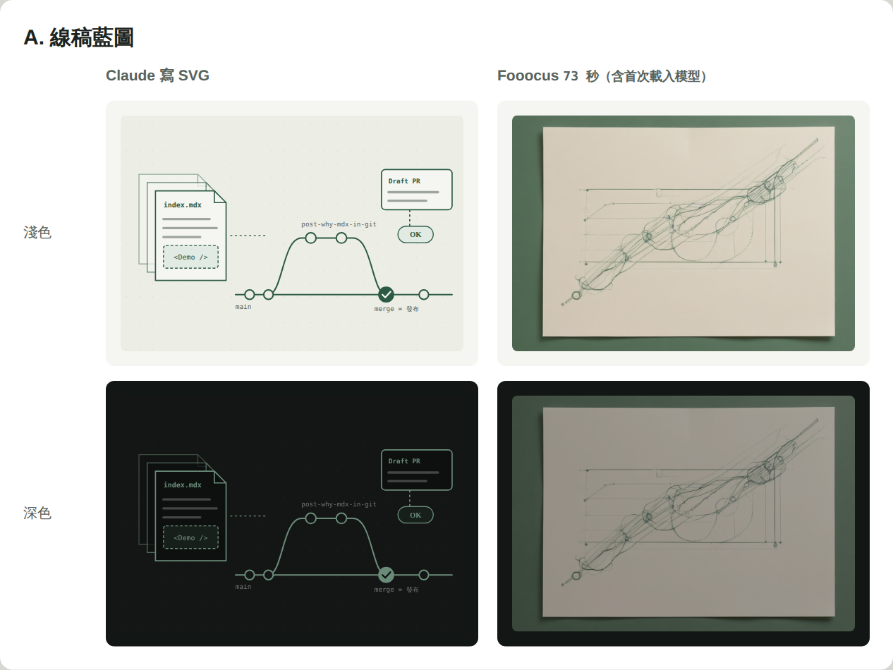
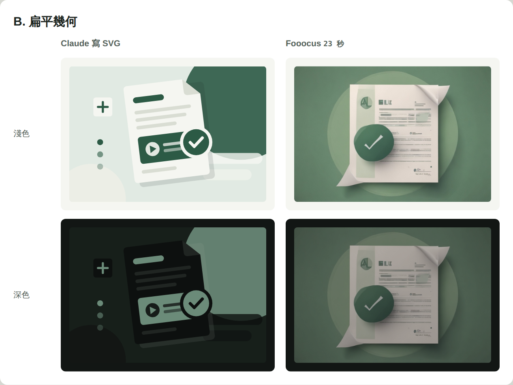
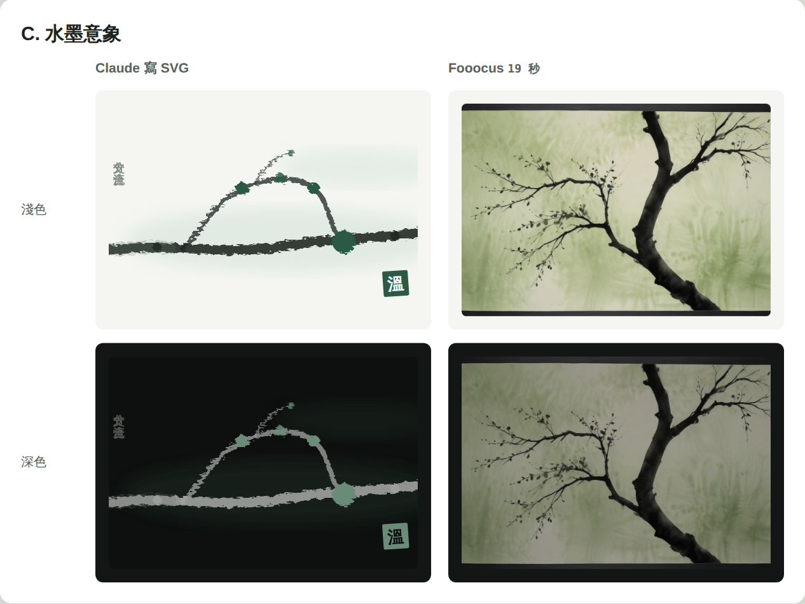
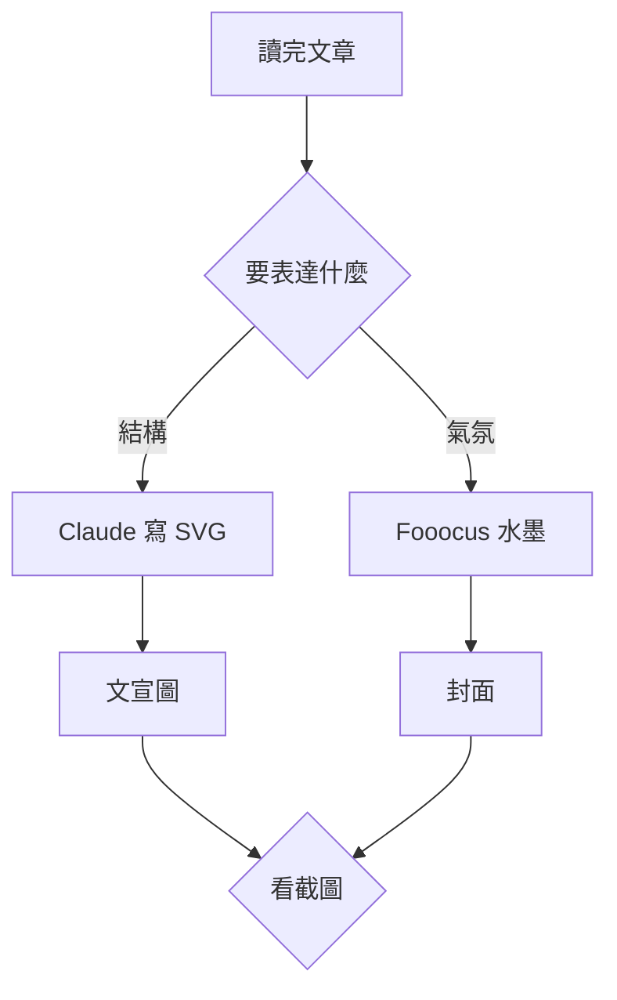
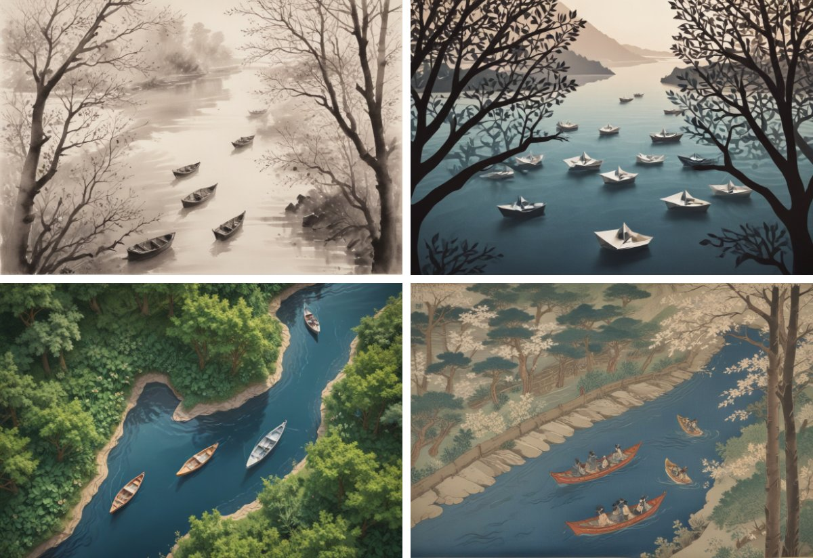

這篇文章的封面，是我筆電上的 Fooocus 花 19 秒畫出來的。

這個網站原本就不用找圖：每篇文章都有一張用網址代號當種子、程式畫出來的等高線封面，文宣圖也是程式排版。乾淨、一致，但看久了……每一篇都長得像同一張地圖。我想要的是「跟這篇文章有關」的插圖，於是拿第一篇文章〈為什麼這個網站的文章寫在 git 裡〉當實驗品，讓 AI 用兩種方式各畫三種風格，看看誰適合當封面。

## 兩種「讓 AI 畫圖」的方式

一開始我想的是：Remotion 都能用程式做動畫了，畫一張封面應該不難吧？後來才想清楚，Remotion 本身不會畫圖，它是讓 AI 寫 React 程式碼，再把畫面輸出成影片。所以「讓 AI 畫圖」其實有兩條路：

| | 方式 | 擅長 | 不擅長 |
| --- | --- | --- | --- |
| A | Claude 讀完文章，直接寫一張 SVG 向量圖 | 精確的結構、網站色票、深色模式自動換色 | 筆觸質感，看得出是程式模擬的 |
| B | 本機 Fooocus 跑 SDXL 模型產圖 | 真實的筆觸、暈染和氛圍 | 精確的結構，而且會畫出亂碼字 |

我讓兩邊都畫同樣三種風格：線稿藍圖、扁平幾何、水墨意象。

## 讓 Claude Code 操作 Fooocus

Fooocus 是開源的 SDXL 產圖工具，跑在我自己的電腦上，介面是 Gradio。它沒有正式的 API 文件，但 Gradio 的介面本身就能用程式呼叫。我把 `http://127.0.0.1:7865/?view=api` 丟給 Claude Code，它從 WSL 連進去，自己把流程摸清楚：

1. 找出生圖的端點：一個要吃 152 個參數的函式，負責建立任務。
2. 用同一個 session 呼叫下一個端點，任務才會真的開跑。
3. 從回傳的圖庫拿到檔案路徑，再下載圖片。

第一輪用預設的 Speed 模式，等太久。我把 Fooocus 介面上的效能改成 **Lightning**、一次一張、輸出 jpeg，速度就上來了：

| 風格 | 產圖時間 |
| --- | --- |
| 線稿藍圖 | 73 秒（含第一次載入模型） |
| 扁平幾何 | 23 秒 |
| 水墨意象 | 19 秒 |

我的筆電是 RTX 3050 Ti，只有 4GB 顯示記憶體，模型熱起來之後大約 20 秒一張，起草一篇文章時順便產幾張候選圖，完全等得起。

## 結果：誰畫結構，誰畫意境

線稿藍圖是最明顯的對比。Claude 寫的 SVG 把「檔案 → 分支 → PR → 合併」畫得清清楚楚；Fooocus 雖然配色對了、也有手繪的質感，但分支和合併的結構完全不見，只剩一團纏在一起的線。

扁平幾何也是 SVG 勝出。Fooocus 畫的文件上出現了「AL」「FLK」這種亂碼字，就算在提示詞裡排除文字，它還是會畫。

水墨就反過來了。SVG 用濾鏡模擬的筆觸，跟 Fooocus 畫出來的枯筆和暈染一比，馬上就分出高下。

結論很清楚：要把結構講清楚，程式畫的 SVG 一筆不差；要營造氣氛，Fooocus 的筆觸和暈染明顯勝出……兩個工具各有所長，不必硬選一個。

## 混用方案

- **封面交給 Fooocus。** 每篇依主題畫一張意境圖。這篇講的是兩種工具匯流成一套做法，所以封面畫的是瀑布匯入河流。網站本來就支援為每篇文章指定一張封面圖，社群分享的預覽圖也會跟著用。
- **文宣圖交給程式。** 流程圖版和終端機版需要精確的步驟和指令，這篇的文宣圖就是流程圖版。
- **圖片在起草時就產生，存進 git。** GitHub 的 CI 和 Vercel 上都沒有 GPU，所以圖只能在我的電腦上產生。這剛好符合網站的規矩：AI 只負責起草，我看過截圖說 OK，合併之後才上線。

還有兩個限制要接受：SDXL 寫不好字，所以插圖裡一律不放字，標題由文宣圖版型疊上去；深色模式下，點陣圖只能整張調暗，沒辦法像 SVG 那樣換成深色的色票。

## 後來：正式寫進寫文章的流程

這篇文章發布後，我把這套做法正式寫進那份寫文章用的 skill。動手之前，我先改變了一個想法：封面不必每篇都是水墨。既然要展示 AI 自己畫圖的能力，風格就該跟著文章走。

問題是 Fooocus 內建 279 種風格，我還摸不清哪些適合當封面。所以先做了一輪試驗：拿兩篇文章當題目，各挑 12 種候選風格，同一篇用同一段畫面描述、同一個隨機種子，只換風格，一共 24 張，每張 16 到 29 秒。

排成一頁對照表之後，看出三件事：

- **24 張都沒有亂碼字。** 在反向提示詞裡排除文字之後，這個老問題沒有再出現。
- **抽象的結構畫不出來。** 我描述「河流分岔再匯流」，想暗示 git 的分支與合併，結果 12 種風格全都只畫出一條河。跟前面的線稿藍圖一樣：要講結構，還是得靠程式畫。
- **畫面太滿，風格就消失。** 另一篇的描述同時有房子、人、機器人和日出，結果好幾種風格都畫成了幾乎一樣的寫實夕陽。畫面描述要簡單，只放一個主角。

我從 12 種裡留下 7 種：水墨、墨繪、平面剪紙、立體剪紙、等角、浮世繪和向量插畫，連同每種適合什麼主題、要注意什麼，寫成一份清單。現在 AI 起草一篇文章時，會從清單裡挑一種風格、寫一段畫面描述，畫 3 張候選，挑一張當封面，並在 pull request 裡說明為什麼這樣選。我不滿意的話，說一句「換第 2 張」就好。

如果起草時我的電腦沒開 Fooocus，文章就先用程式畫的等高線封面，pull request 裡會註明「封面待補」，不會卡住整個流程。

## 接下來

〈[為什麼這個網站的文章寫在 git 裡](/posts/why-mdx-in-git)〉就是第一篇走完新流程的文章，它的剪紙封面就是這樣挑出來的。下一步是文宣圖：等高線版的文宣圖要改成可以用這張封面當背景，讓分享到社群的圖片也帶著每篇文章自己的畫面。
