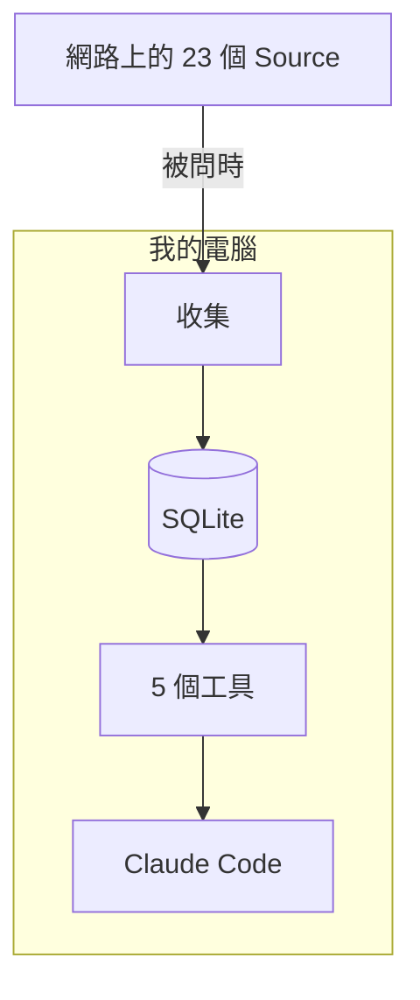
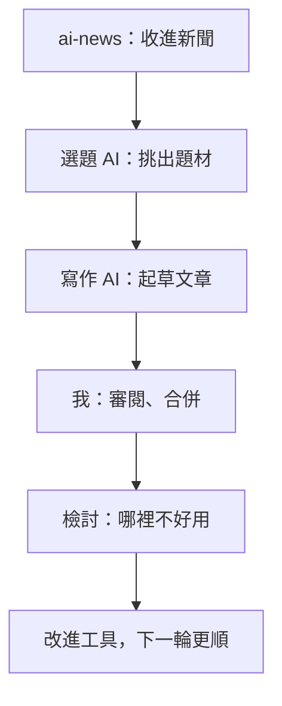

我做了一個工具，每天把 AI 新聞餵給我的寫作 AI。結果第一個嫌它不好用的，就是那個 AI。

那是 2026-11-12 凌晨，這個工具上線的第一天。我請 AI 從一週的新聞裡幫我挑下一篇文章的題材，它讀了將近 280 則新聞，交出五個候選題材。做完我照例請它檢討這次的過程，它的第一條意見很直接：這次大部分的 token，花在讀工具回傳的摘要上，而它真正用到的，幾乎只有標題。

於是我開了一張工單、寫測試、改程式，天亮之前，修正版 0.2.0 已經發布到 PyPI 上了。

這篇要拆解的，就是這個工具：[ai-news-mcp](https://github.com/duncan-wen/ai-news-mcp)。它從 23 個 Source 收集 AI 新聞到我的電腦裡，讓 Claude 用一句話就能問「最近有什麼新的」。它最反直覺的地方是：**一個整理 AI 新聞的工具，自己卻從不呼叫 AI。**

## 為什麼要自己做

我想每天掌握 AI 的動態，但新聞散在幾十個地方：各家公司的官方部落格、科技媒體、工程部落格、版本發布頁、Hacker News、Product Hunt、模型平台。一個一個網站看，看到一半就累了。

真的動手整理之後，才發現麻煩不只是「多」：

- **有些來源根本沒有 RSS。** Anthropic 的 `/rss.xml`、`/news/rss.xml`、`/feed.xml` 全部回 404。
- **有些一次給太多。** OpenAI 的 RSS 一次塞出 1,375 則，大約 1.1 MB，等於把整個歷史都倒給你。
- **同一件事會在好幾個地方重複出現。** Google 發表新模型，官方部落格、The Verge、Hacker News、OpenRouter 各來一次。

我想要的其實很簡單：在 Claude Code 裡直接問一句「有什麼新的」，就拿到整理好的答案。

2026-11-11，我決定自己做一個。凌晨 01:18 第一個 commit，晚上 22:16 最後一個功能 commit，中間 36 個 commit。開發流程和這個網站一樣：先訪談、寫規格、拆工單，測試先行，每張工單做完就檢討，細節在〈[創世紀：一天之內，我和 AI 怎麼蓋出這個網站](/posts/how-this-site-was-built)〉寫過，這篇不再重講。這次最大的感受是：有 AI 輔助，我不再怕「自己造一個工具」這件事。一天就有了第一版，對我來說，那像是快了 100 倍。

## 整體長什麼樣

它是一個 MCP server。MCP（Model Context Protocol）是讓 AI 呼叫外部工具的標準介面，Claude Code、Claude Desktop、Cursor、VS Code 都支援。整個架構一張圖就說得完：



收進來的每一則新聞叫一個 Item，分成四個 Category：News（產業動態）、Applications（馬上能用的產品）、Engineering（怎麼打造 AI 系統）、Models（新模型和它們的能力、價格）。一則 Item 可以同時屬於好幾個。

Claude 能用的工具有五個：`whats_new` 看上次之後的新東西、`search` 依關鍵字和時間搜尋、`read_item` 讀某一則的全文、`list_sources` 看哪些來源正常、`collect_now` 立刻重新收集。

整個專案大約 3,500 行 Python，85 個測試，每次 push 都在 Linux、macOS、Windows 和三個 Python 版本上跑一遍，共 9 個 job。

## 三個刻意的「不要」

這個工具的形狀，主要是由三個「不要」決定的。每個決定都寫成了一份決策紀錄，記下當時考慮過什麼、為什麼沒選。

### 不要排程器：有人問的時候才收集

新聞工具的直覺做法，是設一個每小時跑一次的排程。我刻意不要。

server 只在三種時候自己收集：啟動時資料超過 24 小時、有人呼叫 `whats_new` 而資料超過 24 小時、有人呼叫 `collect_now`。`whats_new` 最多等 90 秒，等不到就先回現有的資料，附一句「還在收集，等一下再問」。

為什麼？每個人都在自己的電腦上跑它，常常是 WSL，或是一台不一定開著的筆電。排程器是多一個要裝、要除錯的東西，而且它停了也不會有人知道。資料新不新，只在有人問的那一刻才重要……而那一刻，server 一定開著。

我否決了三個替代方案：

- **每次查詢都即時去抓**：光 OpenAI 就一次 1,375 則，每次重抓既慢、又要重新去重複，也留不下「上週發生了什麼」的歷史。
- **用作業系統的排程器**：每個平台設定方式都不同，電腦關著就不會跑。
- **放到 GitHub Actions 上定時跑**：抓下來的資料還得同步回每個人的電腦。

### 不要 LLM：server 只管進貨，Claude 負責講解

這是最反直覺的一個決定：一個 AI 新聞工具，收集時完全不呼叫任何 AI 模型。它不摘要、不細分類、也不合併同一件事的多篇報導。分類只靠每個 Source 預設的 Category，加上一組關鍵字規則。

你可以把它想成一間店。server 是倉庫，只管進貨、上架、貼標籤；Claude 是店員，負責聽懂客人要什麼、去架上挑、再用客人聽得懂的話講解。呼叫工具的 Claude 本來就會讀每一筆結果，如果倉庫先找另一個 AI 把貨整理一遍，等於同一件事付兩次錢。

這個決定帶來兩個好處：

- **不需要任何 API key，跑起來零成本。** 這對一個開源工具很重要：裝上就能用，不用先去申請帳號。
- **不綁定 Claude。** server 只回資料，所以任何支援 MCP 的 client，配上它自己用的模型都能用。不過我只在 Claude 上測過，文件也照實這樣寫。

代價是關鍵字規則會分錯一些。但一則 Item 可以屬於好幾個 Category，Claude 查詢時也會自己重新判斷，所以分錯的成本不高。去重複也只合併「網址正規化之後相同」的 Item，不去猜兩篇報導是不是在講同一件事。

### 不要雲端：資料就放在你的電腦裡

所有資料都在本機的一個 SQLite 檔案裡。沒有帳號、沒有伺服器、沒有要付月費的東西。第一次收集會往回抓 30 天，所以裝好之後第一次問，大約要等一分鐘。

## 寫給 AI 用的介面：說明文字就是 API

做這個工具，我學到最多的不是爬蟲，而是：**當使用者是 AI，工具的說明文字就是 API 的一部分。** Claude 決定要呼叫哪個工具、帶什麼參數，靠的就是那幾行說明。

### 一個會改狀態的「讀取」

`whats_new` 的行為是：回傳上次看過之後的新東西，然後把「上次看到哪」的記號移到現在。這個動作無法復原。

問題出在選錯工具的代價不對稱。使用者問「今天有什麼新聞？」，該用 `search` 的時候用了 `whats_new`，那些新聞就被標成看過，下次再也不會出現；反過來，該用 `whats_new` 卻用了 `search`，什麼也沒損失。

我考慮過加一個「這次不要標成看過」的參數，但否決了：問題本身是模糊的，加了參數，AI 還是不知道該不該帶。最後的解法是程式一行都不改，只改說明文字：

```text
Use only when the user asks for what is new since they last looked:
what's new in AI or in some Categories, anything new, today's briefing.
Calling it marks Items as seen and cannot be undone, so for anything
else use `search`, which never does.
```

只有使用者明確問「上次看過之後有什麼新的」才用 `whats_new`，帶時間（「今天」、「這週」）或帶主題的問題，一律交給 `search`。拿不準的時候，選那個不會造成損失的。

### 每個分類各記各的

「上次看到哪」的記號叫 Checkpoint，我刻意讓每個 Category 各有一個，而不是全部共用一個：


如果只有一個共用的記號，早上只問了 Models，當天的 News 也會被一起標成看過，永遠不會出現在你面前。

還有一個細節：記號比的是**收集進來的時間**，不是新聞的發布時間。有些 feed 的發布時間不準，或者文章晚了好幾天才出現在 feed 裡；如果比發布時間，這些新聞就會悄悄漏掉。

### 回傳多長，也是設計的一部分

這就回到開頭那個抱怨。

原本的 `search` 每一筆都附上大約 500 字的摘要，`read_item` 則把整篇全文丟回去。對人來說，資料多一點只是多捲幾下；對 AI 來說，每一個字都佔用它的工作記憶（context），也都要付錢。一週將近 280 則新聞、每則 500 字，大部分它根本不需要讀。

修法是把長度交給呼叫的人決定：

- `search` 多了一個 `summary_length`，可以把摘要調短，設成 0 就只看標題。預設還是 500，舊的用法不受影響。
- `read_item` 預設最多回 10,000 字，並且明確告訴對方「這段被截斷了，全文有多長」，需要更多就再呼叫一次、把上限調高。

同一次檢討還多了一條規則：`read_item` 讀不到某個網站時，選題的 AI 要先換個方法讀、再找其他報導，都不行才放棄那個題材，並說明原因。

## 踩到的坑

### Anthropic 沒有 RSS

我試了 Anthropic 網站上各種可能的 RSS 網址，全部 404。網頁裡也沒有宣告任何 feed。公開的 RSS 轉換服務 RSSHub 回 403，還附上說明：這個公開站只供測試用。

最後改讀它的 sitemap：一份列出網站所有網址的清單，裡面有 280 個 `/news/` 和 217 個 `/research/` 網址。不是每個來源都會乖乖給你 RSS，有時候得自己找一條路。

### 一開到 Windows 就壞

開源前，我把 CI 從只跑 Linux 擴成三個作業系統。有一處是事先想到的：Windows 預設的文字編碼讀不了中文的說明文件，所以在 CI 跑之前，就把所有讀寫文字檔的地方都改成明確指定 UTF-8。

有一處沒想到。第一次跑三平台 CI，Linux 和 macOS 的 6 個 job 全過，Windows 的 3 個全掛，連型別檢查都過不了：兩個測試用了 `time.tzset()` 切換時區，而這個函式只有 Unix 有。最後改成在 Windows 上跳過這兩個測試。

教訓很簡單：**沒在那個平台跑過，就不能說支援那個平台。** 後來我把這兩個教訓變成本機就跑得到的檢查，不用等推上 GitHub 才發現：本機檢查會另外用 macOS 和 Windows 的設定各跑一次型別檢查，像 `tzset` 這種只有某個平台才有的函式會直接被抓出來；測試裡沒指定編碼的讀寫，一律算失敗。我實際驗證過：拿掉一個指定編碼的參數，12 個測試立刻變紅。

## 開源時的兩個取捨

- **發布不存任何 token。** 用 PyPI 的 Trusted Publishing：推一個版本 tag，GitHub Actions 憑 OIDC 向 PyPI 證明身分，先跑完三個平台的檢查、確認 tag 和套件版本一致，才發布。同一套機制也自動更新 MCP 官方的 Registry，0.2.0 就是第一次全自動發布。
- **安全說明照實寫。** `read_item` 會去抓新聞的原始網址，而那個網址來自 Source 的 feed，server 也會跟著轉址走。如果某個 Source 被入侵，或使用者自己加了一個惡意的 Source，就可能讓它去抓區域網路裡的網址。這件事我寫進了安全說明裡，而不是假裝它不存在。

## 你也可以試試

用 Claude Code 的話，一行就裝好：

```bash
claude mcp add --scope user ai-news -- uvx ai-news-mcp
```

開一個新的 Claude Code session，問它：「AI 最近有什麼新消息？」第一次要等一分鐘左右，它正在收集。用 Claude Desktop、Cursor 或 VS Code 的話，[README 的安裝說明](https://github.com/duncan-wen/ai-news-mcp#install)裡有各自的設定。

接著可以試試：

- 「找上週關於 MCP 的 Engineering 文章」
- 「讀第二篇的全文，幫我摘要」
- 「哪些新聞來源抓不到？」

對我來說，它現在是這個部落格的起點。我用一句話問 AI「最近有什麼值得寫的」，它就從這個工具裡挑出題材；寫完、我審閱合併、文章上線，再檢討這一輪哪裡卡住，改進工具本身：



這個工具上線的第一天，它最認真的使用者是我的 AI，而它的抱怨在天亮前就變成了新版本……下一次它挑出的題材，會讀得更快一點。
