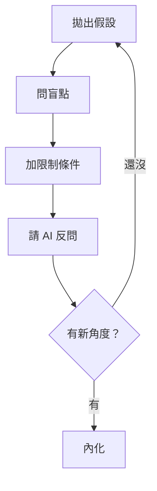
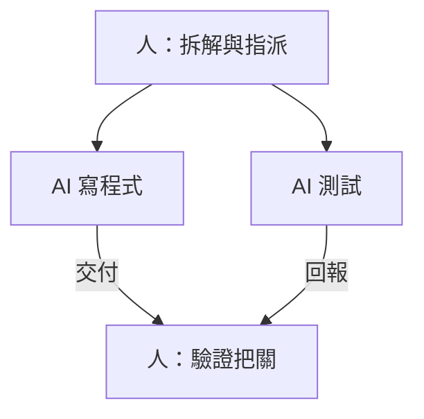

「如果你把思考外包給 AI，人類的大腦反而會退化。」

看完臺大演講網上簡立峰博士的〈[善用 AI 成為 1% 的超級人才](https://www.youtube.com/watch?v=lPNPaSzjm9E)〉，留在我腦中最久的不是「AI 會取代誰」，而是這一句。這是「人文與科技的對話」系列的一場演講，談的不是哪個模型比較強，而是人跟 AI 協作時的位置：同樣在用 AI，有人越用越強，有人越用越鈍，差別在哪裡。

我平常寫程式幾乎都跟 AI 一起，這個網站的文章也是先交給 AI 起草、我審過才發布，所以整場聽下來一直在對照自己：我是在用 AI 擴展腦袋，還是在把腦袋交出去？下面是我整理的重點，文末附上整場濃縮成的 15 頁投影片。

## 最大的危機，是思維外包

演講先交代背景：AI 正從「對話模式」的語言模型，跳到能自己規劃、自己執行的全自動代理 (Agentic AI)。邏輯推理已經到博士等級，Gemini 從數學奧林匹亞的銀牌升到金牌，還解開了 ICPC 世界程式設計競賽的難題；網頁和軟體也開始不只設計給人用，而是設計給 AI 代理讀。

在這種速度下，被取代反而不是最急的事。演講描述的退化是一步一步來的：先是習慣一問一答，只想拿到標準答案；接著失去批判和推演的能力；最後連決策都交出去，成了機器的單純執行端……真正的強者，是利用 AI 擴展大腦的邊界，而不是把思考權讓渡給機器。

## 99% 和 1% 的差別

同樣打開對話框，演講把使用者分成兩種：

| | 99% 的平庸使用者 | 前 1% 的超級人才 |
| --- | --- | --- |
| 思維 | 尋找標準答案 | 尋找洞察、靈感與盲點 |
| 互動 | 一問一答，形同抄襲 | 十問十答，反覆迭代與共創 |
| 定位 | AI 的操作員 | AI 的管理者與架構師 |
| 產出 | 節省時間，提早下班 | 打造分身 (Agent)，24 小時擴增產出 |

右邊那一欄怎麼做到，演講拆成四個動作：問、用、管、造。

## 問：先掌握定義脈絡的權力

好答案來自好問題 (Good answers come from smart ask)。一個好的提問有四個部分：

- **角色 (Role)**：給 AI 一個明確的專家視角。
- **脈絡 (Context)**：把人、事、時、地、物的背景限制交代完整。
- **格式 (Output)**：指定輸出結構，例如表格、程式碼或分析報告。
- **專業限制 (Precision)**：用行話和術語，喚醒 AI 底層的專業知識。

這一段我很有感。這個網站讓 AI 寫文章，靠的就是一份事先寫好的說明書：文風、用詞、格式、哪些話不能寫，全部攤開來給它。脈絡交代得越清楚，第一版就越接近我要的樣子，我要改的地方也越少。

光問一次還不夠。演講說一問一答等於知識抄襲，十問十答才是把知識內化：

對話拉長之後要注意模型的極限：即使有百萬 Token 的上下文，聊太久它還是會「失憶」。適時請 AI 輸出一份摘要，帶著摘要重開一個對話，比硬撐下去可靠。

演講還提到一個語言上的現實：AI 的底層是 Token，訓練資料裡英文佔七成以上，簡體中文約 2%，繁體中文不到 0.01%。直接用繁中處理複雜邏輯，容易讓 AI「降智」和「失憶」。建議的做法是先請 AI 把專業問題轉成英文，在英文裡推演完，再把最後的結果翻回繁體中文。

## 用：找到人機協作的切入點

不是每件事都該交給 AI。演講用兩個軸來分：一個是數位資訊的密度，一個是實體環境和情緒的複雜度。

程式碼、資料分析、文案策劃這類高資訊、低實體的工作，可以大量交給 AI。可是像水電師傅面對未知狀況的耐受度、突發狀況下的 EQ、要動用多種感官的綜合判斷，這些高情緒、高實體的事，是人類不可取代的領域。演講的說法是：讓 AI 去處理 3000 種情境的資料檢索，人專注在真實的情緒連結。

## 管：從執行者升格成品管和產品經理

這是我最常對照自己的一段。演講的圖是這樣：人站在中間當樞紐，底下一個 AI 負責寫程式，一個 AI 負責測試，人負責驗證和把關。

人的核心價值會變成兩件事。一是品管 (QA)：有能力認出 AI 的幻覺、錯誤和平庸產出，把重心放在驗證和架構把關。二是產品經理 (PM)：把龐大的任務拆成小模組，準確地指派給不同專長的 AI 代理。

我現在做這個網站的方式就很接近這張圖。程式由 AI 寫，檢查和截圖由腳本跑，我做的事是看截圖、判斷哪裡不對、決定要不要合併。手上敲的程式碼少了很多，但需要判斷的地方反而多了。

## 造：讓分身在你睡覺時工作

最後一步，是從「下班後自己熬夜學習」進化到「睡覺時讓 AI 幫你學習」。演講舉了三個分身的例子：一個統籌專案進度，一個整合智慧手錶的數據做健康提醒，一個每天自動追蹤 100 多個主題、比對趨勢並寫成摘要。目標是打破每天 24 小時的限制，建立一個自己的自動化智庫。

往組織的角度看，就是「一人獨角獸」(One-Person Unicorn)。企業的外包需求在下降，因為內部員工已經能用 AI 吸收基礎工作。演講提到兩個案例：一位矽谷前產品總監，不請人類工程師，和 7 到 8 個「AI 同事」一起建立並經營新創公司；還有一個虛擬自販機實驗，AI 代理在 365 個虛擬天數裡自己發出 3000 封招商信並且獲利，全程沒有人類介入。

## π 型人才：兩根柱子加一根橫樑

演講最後收在 π 型人才。第一根柱子是核心專業，包括說不出來的內隱知識 (Tacit Knowledge) 和對真實世界的物理感知；第二根柱子是跨界視角，用另一個領域的常識，加上 AI 補足技術落差，做出跨界的應用；頂上的橫樑，就是「問、用、管、造」的架構，加上同理心、領導力和跨領域協商的軟實力。人類獨特的廣度組合和實體感知，是爬蟲抓不走的優勢。

還有一個公式：資本（算力）加上深度思考（迭代），等於指數級的知識複利。知識型產業正在變得像製造業，花越多算力讓機器推演，得到的知識越精準；而能把這份算力用好的，是掌握高階提問策略的人。

## 15 頁投影片：整場演講的骨架

如果想一次看完整條脈絡，下面這 15 頁從思維外包的危機講起，經過 99% 和 1% 的對照、「問、用、管、造」四個動作，一路到 π 型人才和算力即知識，可以一頁一頁翻：

<SlideDeck />

## 下一次打開對話框之前

投影片最後一頁寫著：「AI 已經讀完了人類一億本書，而你的故事才剛開始。」

與其擔心被取代，不如先從最小的一步開始改：下一次打開對話框，別急著要答案，先把角色、脈絡、格式和限制寫清楚，再多問它幾輪，最後請它反過來問你……那個定義脈絡的人，才是整段對話真正的主人。The prompt is waiting。你，要問什麼？
