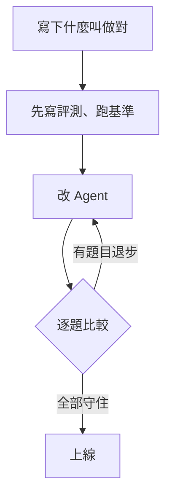

加了開單工具之後，平均分數一動也沒動：60%，跟加之前一模一樣。

這個結果來自一個很小的實驗。我替一個公司內部助理 Agent 準備了 22 題考題，先讓它考一次，再幫它加上「開 IT 工單」的工具，然後重考。本來以為會看到 [What Is Eval-Driven Development? How to Improve AI Agents](https://www.langchain.com/blog/what-is-eval-driven-development) 裡寫的那種翻車：工具描述寫得太寬，連「怎麼設定 VPN？」這種教學問題都被拿去開單。結果我的 Agent 翻在另一邊……它一張單都沒開。

平均分數看不出這件事，逐題看才看得出來。這篇記錄整個過程：怎麼先寫評測，怎麼跑出四個版本的分數，以及最後真正修好問題的，是哪一行字。

## 先寫評測，再寫功能

LangChain 那篇文章把這套做法叫做 eval-driven development（評測驅動開發），借的是 TDD 先寫測試、再寫程式的想法。差別在 Agent 的輸出不固定：同一個問題問三次，可能拿到三種答案，也可能某一次挑錯工具。所以評測不是「過或不過」，而是「每題跑幾次、過了幾次」。

流程只有三步：



我的 Agent 是一家虛構公司「大河科技」的內部助理，原本有兩個工具：查內部文件（`search_docs`）和上網查（`web_search`）。這次要加的新功能是開 IT 工單（`create_ticket`）。動手之前，先把「什麼叫做對」寫成一張表：

| 員工在說什麼 | 應該呼叫 | 例子 |
| --- | --- | --- |
| 東西壞了、需要 IT 動手 | `create_ticket` | 我的筆電連不上 VPN，一直顯示驗證失敗 |
| 問規定、流程、設定教學 | `search_docs` | 怎麼設定 VPN？ |
| 一般知識 | `web_search` | VPN 的原理是什麼？ |

我故意讓三類題目都出現「VPN」和「筆電」。同一個關鍵字，有時要開單，有時要查文件，有時要上網，這正是工具描述最容易寫錯的地方。

## 22 題考題，留 6 題不看

考題分成兩組：16 題是**開發組**，改 Agent 的時候會看；另外 6 題是**保留組**，改的過程中我刻意不去看它錯在哪。如果開發組分數一直上升，保留組卻停在原地，就代表我在對著考題調答案，而不是真的讓 Agent 變好。

每一題都長這樣：

```json
{
  "id": "t1",
  "split": "dev",
  "expected": "create_ticket",
  "input": "我的筆電連不上 VPN，一直顯示驗證失敗"
}
```

評分不需要另一個 AI 來當裁判。要檢查的只是「第一個呼叫的工具對不對」，用程式比對就好，結果穩定又不花錢：

```python
calls = data["choices"][0]["message"].get("tool_calls") or []
got = calls[0]["function"]["name"] if calls else "(none)"
passed = got == example["expected"]
```

模型用的是 DeepSeek 的 `deepseek-v4-flash`，每題跑 3 次，所以開發組滿分是 48 次，保留組是 18 次。

## 四個版本的分數

| 版本 | 改了什麼 | 開發組 | 保留組 |
| --- | --- | --- | --- |
| v0 | 基準：還沒有開單工具 | 29/48（60%） | 12/18（67%） |
| v1 | 加上開單工具，描述寫「用於 VPN 與筆電問題」 | 29/48（60%） | 11/18（61%） |
| v2 | 開單工具的描述改窄：只在要 IT 動手時使用 | 36/48（75%） | 15/18（83%） |
| v3 | 系統提示也講清楚什麼時候開單 | 46/48（96%） | 18/18（100%） |

### v0：基準，先確定哪裡會錯

還沒有開單工具，「該開單」的 8 題當然全錯，Agent 都拿去查內部文件。這一步看起來像白跑，其實是在確認兩件事：考題真的分得出好壞，而且其他兩類題目原本就答得對。之後哪一題退步，才有東西可以比。

### v1：分數沒動，問題藏在逐題結果裡

加上開單工具後，開發組還是 60%。只看平均分數，會以為「沒差，至少沒變壞」。逐題打開來看，才發現 8 題該開單的題目，24 次裡沒有一次呼叫 `create_ticket`：

```text
FAIL t1 我的筆電連不上 VPN，一直顯示驗證失敗 -> ['search_docs', 'search_docs', 'search_docs']
FAIL t6 VPN 從昨天開始每十分鐘就斷線一次   -> ['search_docs', 'search_docs', 'search_docs']
```

保留組還從 67% 掉到 61%：「筆電電池怎麼用比較不會老化？」有一次被拿去查內部文件。單一次的波動不能說明太多，但如果只看總分，這種退步會被平均掉。

### v2：把描述改窄，開始會開單了

我把開單工具的描述改成「只用在員工回報東西壞了、或需要 IT 替他開通、更換設備的時候。員工問『怎麼做』『怎麼設定』的教學問題不要開單」。開發組升到 75%，投影機壞掉、螢幕全黑這幾題開始會開單了。

但「VPN 驗證失敗」「信箱被鎖住」「新人報到要開帳號」這三題，還是每次都去查文件。

### v3：真正的原因在系統提示

回頭看系統提示，問題就在眼前：

```text
公司內部的規定、流程、設定教學都在內部文件裡；其他一般知識請上網查。
```

這句話只告訴模型兩條路：查內部文件，或上網查。工具清單裡多了一個開單工具，但在系統提示的世界觀裡，它根本不存在。工具描述寫得再好，也敵不過系統提示一開始就畫好的地圖。

我在系統提示加上一句「員工回報東西壞了、或需要 IT 動手開通、更換時，開 IT 工單」，開發組跳到 96%，保留組 18 次全對。剩下唯一沒過的，是「新人下週一報到，需要幫他開帳號和準備一台筆電」，3 次裡有 2 次被拿去查文件。這題確實有點模糊：它聽起來也像在問「新人報到流程是什麼」。

## 平均分數會說謊

回頭看這四次實驗，最有用的不是最後那個 96%，而是 v1 那次「沒變」。

- **一定要逐題看。** v1 的平均分數跟 v0 一樣，但新功能一次都沒被用過。只看總分，我會以為這個工具上線了，其實它從來沒被呼叫。
- **保留組是照妖鏡。** 從 v2 到 v3，開發組和保留組一起上升，代表改的是 Agent 的理解，不是對著考題調答案。
- **工具描述之外，還有系統提示。** LangChain 的例子是工具描述太寬；我的例子是系統提示太窄。兩種翻車方向相反，但都要靠評測才看得出來。

先寫評測最大的好處，是把「感覺好像變好了」換成可以比較的數字。下次替 Agent 加新工具之前，可以先寫十幾題考題、留幾題不看，跑一次基準……改完之後，逐題看它到底改變了什麼。
