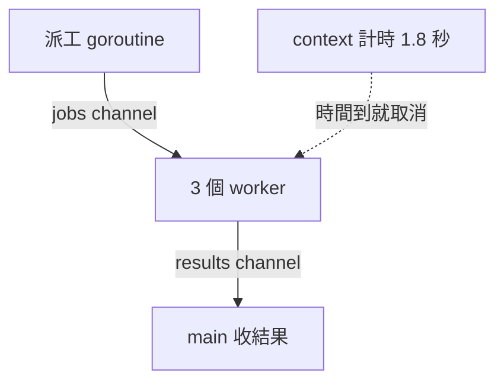

10 萬個 goroutine 同時活著，整個程式只多用了 277 MB 記憶體，作業系統那邊看到的執行緒，只有 9 條。

上一篇我拿 [Python 的三種並行](/posts/python-concurrency-models) 實測了一輪，看到 4 條執行緒被 GIL 綁住、跑得比依序執行還慢。這次換成 Go，想把常聽到的那句「Go 天生就適合並行」拆開來看清楚：goroutine 到底是什麼、為什麼開 10 萬個也不痛不癢、它們怎麼分到 CPU 上跑，以及並行之後最容易出事的地方。這篇的每一段程式碼，都在同一台 8 核心的電腦上用 Go 1.27 實際跑過，輸出就是我看到的數字。

## goroutine：在函式前面加一個 go

goroutine 是 Go 的輕量執行單位。任何函式呼叫前面加上 `go`，它就會在背景開始執行，呼叫的那一行不會等它跑完：

```go
go sendEmail(user) // 立刻往下走，寄信在背景進行
fmt.Println("已送出")
```

輕量到什麼程度？下面這段程式一口氣開 10 萬個 goroutine，讓它們全部停在同一條 channel 前面等待放行，再量一下記憶體和執行緒數（`wg.Go` 是 Go 1.25 加入的寫法，後面會再講）：

```go
package main

import (
	"fmt"
	"os"
	"regexp"
	"runtime"
	"sync"
)

// osThreads 從 Linux 的 /proc 讀出這個程式目前有幾條作業系統執行緒。
func osThreads() string {
	status, _ := os.ReadFile("/proc/self/status")
	return regexp.MustCompile(`Threads:\s+(\d+)`).FindStringSubmatch(string(status))[1]
}

func main() {
	const n = 100_000
	var before, after runtime.MemStats
	runtime.ReadMemStats(&before)

	release := make(chan struct{})
	var wg sync.WaitGroup
	for range n {
		wg.Go(func() {
			<-release // 先停在這裡，讓 10 萬個 goroutine 同時活著
		})
	}

	runtime.ReadMemStats(&after)
	used := float64(after.Sys - before.Sys)
	fmt.Printf("同時活著的 goroutine：%d 個\n", runtime.NumGoroutine()-1)
	fmt.Printf("多用的記憶體：%.0f MB，平均每個 %.1f KB\n", used/1e6, used/n/1024)
	fmt.Printf("作業系統執行緒：%s 條\n", osThreads())

	close(release) // 放行，大家一起結束
	wg.Wait()
}
```

```text
同時活著的 goroutine：100000 個
多用的記憶體：277 MB，平均每個 2.7 KB
作業系統執行緒：9 條
```

平均每個 goroutine 只佔 2.7 KB。對照一下，Linux 上一條執行緒預設會預留 8 MB 的堆疊空間（`ulimit -s` 顯示的 8192 KB），換成 10 萬條作業系統執行緒，光是預留的堆疊就是 800 GB 等級，多數系統在那之前就會先碰到執行緒數量的上限。

goroutine 便宜，是因為它的堆疊一開始只有 2 KB，不夠用時 runtime 會自動把它搬到更大的空間；而且它不是作業系統的執行緒，建立和切換都在 Go 自己的 runtime 裡完成，不必每次都請作業系統出面。

## 誰在幫它們排班：G、M、P

10 萬個 goroutine 只用 9 條執行緒，中間靠的是 Go 的排程器。它用三個字母描述手上的角色：

- **G**（goroutine）：要做的工作，帶著自己的堆疊和執行到哪裡的紀錄。
- **M**（machine）：真正的作業系統執行緒，CPU 上跑的是它。
- **P**（processor）：執行 Go 程式碼的「名額」，數量等於 `GOMAXPROCS`，預設是 CPU 核心數，我的電腦上就是 8。


可以把它想成一座物流倉庫：P 是 8 張包裝檯，M 是站在檯前的員工，G 是一張張待處理的工單。每張包裝檯旁邊放著自己的待辦籃（本地佇列），員工從籃子裡拿一張工單做；某張工單要等貨到（等 channel、等網路回應），就先把它掛到一旁的等待區，員工馬上拿下一張。

幾個關鍵行為：

1. **等待不佔人。** G 卡在 channel 或網路 I/O 上時，會被停到一旁，M 和 P 接著跑別的 G。這就是 10 萬個 goroutine 在等，卻只需要 9 條執行緒的原因。
2. **卡住的系統呼叫會讓出名額。** 如果 G 做的是會卡住整條執行緒的系統呼叫（例如讀檔），P 會被交給另一條 M，其他 G 不必陪著等。
3. **閒的去幫忙忙的。** 某張檯的籃子空了，它會去別張檯的籃子「偷」一半工作過來（work stealing），8 顆核心才不會一邊忙死、一邊閒著。
4. **跑太久會被叫停。** 從 Go 1.14 開始，runtime 會強制中斷執行太久的 G（非同步搶占），一個死迴圈不會霸占一顆核心不放。

至於為什麼是 9 條而不是 8 條：`GOMAXPROCS` 限制的是「同時執行 Go 程式碼」的執行緒數，runtime 自己還有負責監控和背景工作的執行緒，所以總數會比 P 多一點。

## CPU 密集：真的會用滿多核心

Python 的執行緒受 GIL 限制，同一時間只有一條在跑。Go 沒有 GIL，8 個 P 就是 8 個可以真的同時算的名額。用同樣的數質數任務來驗證，這次數到 200 萬（Go 比 Python 快很多，數 20 萬一下就結束了），跑 4 次：

```go
package main

import (
	"fmt"
	"runtime"
	"sync"
	"time"
)

// countPrimes 純計算：數出 limit 以內有幾個質數。
func countPrimes(limit int) int {
	count := 0
	for n := 2; n < limit; n++ {
		isPrime := true
		for d := 2; d*d <= n; d++ {
			if n%d == 0 {
				isPrime = false
				break
			}
		}
		if isPrime {
			count++
		}
	}
	return count
}

func main() {
	jobs := []int{2_000_000, 2_000_000, 2_000_000, 2_000_000}
	fmt.Println("GOMAXPROCS =", runtime.GOMAXPROCS(0))

	start := time.Now()
	for _, n := range jobs {
		countPrimes(n)
	}
	fmt.Printf("依序執行       %.2f 秒\n", time.Since(start).Seconds())

	start = time.Now()
	results := make([]int, len(jobs))
	var wg sync.WaitGroup
	for i, n := range jobs {
		wg.Go(func() {
			results[i] = countPrimes(n) // 每個 goroutine 只寫自己的格子
		})
	}
	wg.Wait()
	fmt.Printf("4 個 goroutine  %.2f 秒  %v\n", time.Since(start).Seconds(), results)
}
```

```text
GOMAXPROCS = 8
依序執行       1.34 秒
4 個 goroutine  0.38 秒  [148933 148933 148933 148933]
```

快了大約 3.5 倍，4 顆核心同時在算。接下來是我覺得最能說明觀念的一個實驗：把同一個執行檔用 `GOMAXPROCS=1` 再跑一次，只給它一個 P：

```bash
GOMAXPROCS=1 ./primes
```

```text
GOMAXPROCS = 1
依序執行       1.34 秒
4 個 goroutine  1.34 秒  [148933 148933 148933 148933]
```

一樣是 4 個 goroutine，一點都沒有變快。這就是 Go 社群常說的：**並行不是平行**（concurrency is not parallelism）。goroutine 讓你把程式寫成「好幾件事各自進行」的結構，這是並行；有沒有真的在多顆核心上同時算，是平行，要看 P 有幾個。結構寫對了，給它更多核心，它就自己變快。

## 等它們做完：WaitGroup

上面的程式都用了 `sync.WaitGroup`，原因是 Go 有一條很容易忽略的規則：**`main` 一結束，整個程式就結束，還在跑的 goroutine 全部直接消失**，不會等它們做完。

`WaitGroup` 就是一個計數器：開一個工作加一，做完減一，`Wait()` 會等到歸零才往下走。Go 1.25 加入了 `wg.Go`，把這三步包成一個呼叫；在較舊的版本，要自己寫成這樣：

```go
wg.Add(1)
go func() {
	defer wg.Done()
	results[i] = countPrimes(n)
}()
```

<Callout title="注意">

Go 1.22 以前，`for` 迴圈的變數是整個迴圈共用的同一個，goroutine 裡讀到的 `i` 和 `n` 很可能全都是最後一圈的值，要先複製一份（`i, n := i, n`）才安全。從 1.22 開始，每一圈都有自己的變數，上面的寫法才是正確的。看舊程式碼或舊教學時，要留意這個差別。

</Callout>

## 共用記憶體的代價：data race

goroutine 之間共用同一份記憶體，傳資料很方便，同時改同一個變數時就會出事。讓 4 個 goroutine 各把同一個計數器加 10 萬次：

```go
package main

import (
	"fmt"
	"sync"
)

func main() {
	counter := 0
	var wg sync.WaitGroup
	for range 4 {
		wg.Go(func() {
			for range 100_000 {
				counter++ // 讀出來、加一、寫回去：三個步驟，中間可能被插隊
			}
		})
	}
	wg.Wait()
	fmt.Printf("counter = %d（應該是 400000）\n", counter)
}
```

同一個執行檔，我連跑了 5 次：

```text
counter = 267211（應該是 400000）
counter = 183706（應該是 400000）
counter = 175661（應該是 400000）
counter = 313303（應該是 400000）
counter = 324083（應該是 400000）
```

5 次跑出 5 種答案，最差的一次少了一半以上。`counter++` 看起來是一行，實際上是讀出來、加一、寫回去三個步驟，兩個 goroutine 在不同核心上同時讀到同一個舊值，各自加一再寫回去，其中一次加法就不見了。更麻煩的是，它不一定每次都錯，我在別的實驗裡就遇過剛好算對的時候……這種「偶爾才壞」的 bug，最難在測試裡抓到。

好在 Go 內建了偵測工具，執行或測試時加上 `-race`：

```bash
go run -race .
```

```text
==================
WARNING: DATA RACE
Read at 0x00c000018188 by goroutine 8:
  main.main.func1()
...
Found 2 data race(s)
exit status 66
```

它會指出是哪兩個 goroutine、在哪一行同時碰了同一塊記憶體。修法有兩種：用 `sync.Mutex` 把「讀、改、寫」包成一次只能一個人進去的區段，或是對單純的計數改用 `sync/atomic`：

```go
var mu sync.Mutex
mu.Lock()
counter++
mu.Unlock()

// 只是計數的話，atomic 更輕
var hits atomic.Int64
hits.Add(1)
```

改完之後，加上 `-race` 再跑，結果穩定是 400000，也不再有警告。我的習慣是，有 goroutine 的程式，測試一律帶 `-race` 跑一次。

## 用 channel 溝通，而不是共用變數

Mutex 是在保護共用的資料，Go 更推薦另一種思路，官方文件裡那句很有名的話：**不要用共用記憶體來溝通，而是用溝通來共用記憶體**（Don't communicate by sharing memory; share memory by communicating）。

這個「溝通」的管道就是 channel：一條有型別的管子，一端送、一端收。

```go
ch := make(chan int)      // 沒有緩衝：送的人要等到有人接
buf := make(chan int, 10) // 有 10 格緩衝：還有空位就能先放著走

go func() { ch <- 42 }()  // 送
v := <-ch                 // 收，沒東西就等
```

沒有緩衝的 channel 像當面交接，送的一方會停在那裡，直到另一方伸手接過去。這帶來同步的效果，也帶來最常見的錯誤：沒有人接。

```go
func main() {
	ch := make(chan int)
	ch <- 1 // 沒有人在另一端接，這裡永遠等下去
	fmt.Println(<-ch)
}
```

```text
fatal error: all goroutines are asleep - deadlock!

goroutine 1 [chan send]:
```

這個例子 runtime 抓得到，因為所有 goroutine 都卡住了。但真實的服務裡通常還有別的 goroutine 在跑，runtime 就不會報錯，那個卡住的 goroutine 會一直留在記憶體裡，這叫 **goroutine 洩漏**。channel 的使用原則有兩條：

1. **誰送誰關。** 只有送的一方知道「不會再有東西了」，所以 `close` 由送的一方呼叫；對已關閉的 channel 再送會直接 panic。
2. **每個 goroutine 都要有結束的路。** 開一個 goroutine 之前，先想好它在什麼情況下會結束。

## 整合運用：worker pool、select 與 context

把上面的觀念組在一起，就是 Go 最常見的並行寫法：worker pool。情境是 12 個網頁要抓，每個要等 0.5 秒，開 3 個 worker 一起抓，而且整批工作有 1.8 秒的時限，超過就放棄。



這裡多了兩個新角色：

- **`select`**：同時等好幾條 channel，哪一條先有動靜就走哪一條。用它可以寫出「等結果，或是等時間到，看誰先來」。
- **`context`**：在一整串 goroutine 之間傳遞「取消」的訊號。時間到或使用者離開時，所有拿著同一個 `ctx` 的 goroutine 都會從 `ctx.Done()` 收到通知。

```go
package main

import (
	"context"
	"fmt"
	"sync"
	"time"
)

// fetch 模擬一次網路請求：等 500 毫秒，或在 ctx 被取消時提早放棄。
func fetch(ctx context.Context, id int) (string, error) {
	select {
	case <-time.After(500 * time.Millisecond):
		return fmt.Sprintf("第 %d 頁", id), nil
	case <-ctx.Done():
		return "", ctx.Err()
	}
}

func main() {
	ctx, cancel := context.WithTimeout(context.Background(), 1800*time.Millisecond)
	defer cancel()

	jobs := make(chan int)
	results := make(chan string)

	// 3 個 worker 從同一條 channel 領工作
	var wg sync.WaitGroup
	for w := 1; w <= 3; w++ {
		wg.Go(func() {
			for id := range jobs {
				page, err := fetch(ctx, id)
				if err != nil {
					return // 時間到了，這個 worker 收工
				}
				results <- fmt.Sprintf("worker %d 抓完%s", w, page)
			}
		})
	}

	// 派工：送完 12 個工作就關上 jobs，或時間到就停
	go func() {
		defer close(jobs)
		for id := 1; id <= 12; id++ {
			select {
			case jobs <- id:
			case <-ctx.Done():
				return
			}
		}
	}()

	// 所有 worker 都結束後，關上 results，讓下面的 range 跟著結束
	go func() {
		wg.Wait()
		close(results)
	}()

	start := time.Now()
	count := 0
	for r := range results {
		count++
		fmt.Println(r)
	}
	fmt.Printf("%.1f 秒內完成 %d 個，原因：%v\n", time.Since(start).Seconds(), count, ctx.Err())
}
```

```text
worker 2 抓完第 2 頁
worker 3 抓完第 3 頁
worker 1 抓完第 1 頁
worker 2 抓完第 4 頁
worker 3 抓完第 6 頁
worker 1 抓完第 5 頁
worker 3 抓完第 9 頁
worker 1 抓完第 8 頁
worker 2 抓完第 7 頁
1.8 秒內完成 9 個，原因：context deadline exceeded
```

3 個 worker 每 0.5 秒一起完成 3 個，到 1.5 秒時做完 9 個；第 4 輪做到一半，1.8 秒的時限到了，`fetch` 裡的 `select` 收到取消訊號，3 個 worker 各自收工，派工的 goroutine 也停止派工並關上 `jobs`。把時限放寬到 10 秒再跑，12 個全部在 2.0 秒內完成；如果一個一個抓，要 6 秒。

這段程式值得多看一次的，是每一個 goroutine 都有明確的結束方式：

- worker 在 `jobs` 被關上、或收到取消時結束；
- 派工的 goroutine 送完、或收到取消時結束，並負責關上 `jobs`；
- 收尾的 goroutine 等所有 worker 結束後，關上 `results`，讓 `main` 的迴圈結束。

沒有一個會被遺留下來，這段程式加上 `-race` 跑也沒有任何警告。

## 檢查自己懂了沒的幾題

- **goroutine 和執行緒差在哪？** goroutine 由 Go runtime 管理，初始堆疊只有 2 KB，建立和切換都便宜；很多個 goroutine 會被排到少數幾條作業系統執行緒上執行。
- **G、M、P 各是什麼？** G 是工作，M 是作業系統執行緒，P 是執行 Go 程式碼的名額，數量由 `GOMAXPROCS` 決定。
- **開了很多 goroutine，程式就會變快嗎？** 不一定。CPU 密集的工作最多快到 P 的數量；`GOMAXPROCS=1` 時完全不會變快。
- **`main` 結束時，還在跑的 goroutine 會怎樣？** 直接被終止，所以要用 `WaitGroup` 或 channel 等它們。
- **data race 怎麼發現、怎麼修？** 用 `-race` 偵測，用 `Mutex`、`atomic` 或改用 channel 傳遞資料來修。
- **channel 該由誰關？** 送的一方。對已關閉的 channel 送值會 panic，收值則會立刻拿到零值。
- **怎麼避免 goroutine 洩漏？** 讓每個 goroutine 都有結束的條件，需要取消時用 `context` 傳遞訊號。

把這幾個實驗跑完，我最大的收穫不是記住了哪些 API，而是發現 Go 把「開一個 goroutine」變得如此便宜之後，真正的功夫轉移到了另一個問題上：**這個 goroutine 什麼時候結束？**……開之前先答得出這題，channel 誰關、context 傳給誰，也就跟著清楚了。想動手試試的話，從最後那個 worker pool 開始改：把 worker 數、工作數和時限換成不同的值，猜猜看會完成幾個，再跑一次對答案。
