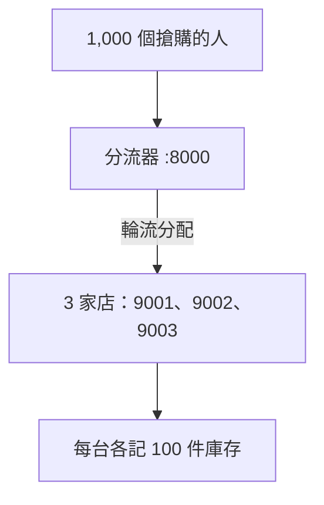
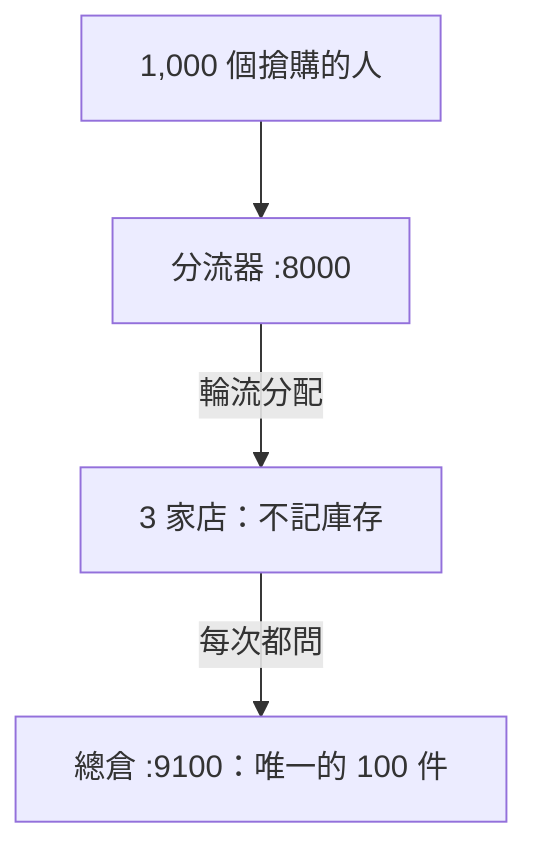

100 件商品，1,000 個人同時搶，結果賣出了 300 件。程式沒有寫錯，我只是把同一個程式多開了 2 份。

上一篇我用 [10 萬個 goroutine 拆解了 Go 的並行](/posts/go-goroutines-explained)，那是一個程式裡面的事。這次把範圍往外推一步，用最簡單的程式，把兩個常被放在一起講的詞分開來看：**高併發**是一台機器同時接住很多人，**分散式**是一台不夠、拆成好幾台一起做。我寫了一間只賣 100 件商品的小店，先讓它一個人扛，再把它複製成 3 台，看看哪裡開始出事。

所有程式都在同一台 8 核心的電腦上用 Go 1.27 跑過，「3 台」是同一台電腦上的 3 個行程，各自佔一個 port，彼此不共用記憶體，跟 3 台真的機器是同一回事；輸出都是我實際看到的數字。

## 高併發：1 萬個人同時敲門

先寫一個最單純的網站：每個請求進來，假裝去查資料庫，等 0.1 秒，再回一個 `ok`。

```go
package main

import (
	"fmt"
	"net/http"
	"time"
)

func main() {
	http.HandleFunc("/", func(w http.ResponseWriter, r *http.Request) {
		time.Sleep(100 * time.Millisecond) // 假裝去查資料庫，等 0.1 秒
		fmt.Fprintln(w, "ok")
	})
	http.ListenAndServe(":8080", nil)
}
```

沒有執行緒池、沒有非同步框架，就這幾行。接著寫一支壓測程式，一口氣開 n 個 goroutine，每個送一個請求，數一數成功幾個、總共花多久：

```go
for i := range n {
	wg.Go(func() {
		url := fmt.Sprintf("http://127.0.0.%d:8080/", i%4+1)
		resp, err := client.Get(url)
		if err != nil {
			return
		}
		io.Copy(io.Discard, resp.Body)
		resp.Body.Close()
		ok.Add(1)
	})
}
wg.Wait()
```

```text
1 個請求，成功 1 個，花了 0.10 秒
100 個請求，成功 100 個，花了 0.11 秒
1000 個請求，成功 1000 個，花了 0.19 秒
10000 個請求，成功 10000 個，花了 0.76 秒
```

1 萬個請求，每個都要等 0.1 秒，一個一個排隊要 1,000 秒；同時處理，0.76 秒就全部做完。

秘密在 Go 的 `net/http` 裡：**每一條連線進來，它就開一個 goroutine 去處理**。上一篇量過，一個 goroutine 只佔幾 KB，等待的時候也不佔執行緒，所以 1 萬個請求同時在等「資料庫」，對它來說就是 1 萬個 goroutine 停在一旁，CPU 根本沒在忙。這就是高併發最核心的一件事：大部分的請求，時間都花在等，誰能便宜地「讓很多人一起等」，誰就接得住人潮。

<Callout title="先卡住的，是壓測的那一端">

第一次跑 1 萬個請求時，只成功了 6,011 個，錯誤訊息是 `cannot assign requested address`。出問題的不是網站，而是壓測程式：每條連線都要佔用本機的一個連線埠，我這台電腦能分配的只有 4,096 個（44620 到 48715），連到同一個位址的連線一多就分不出來了。所以上面的程式輪流連到 `127.0.0.1` 到 `127.0.0.4` 這 4 個本機位址，每個位址各有一份連線埠可用，才跑出 1 萬個全部成功。做壓測時，先確認瓶頸在被測的那一端，量出來的數字才有意義。

</Callout>

## 開一間只賣 100 件的店

光是回 `ok` 太簡單了，真實的服務會記住東西。下面這間店只有 100 件庫存，每個 `/buy` 請求扣一件，扣到 0 就回「賣完了」：

```go
package main

import (
	"flag"
	"fmt"
	"net/http"
	"sync"
)

func main() {
	port := flag.String("port", "9001", "這家店開在哪個 port")
	flag.Parse()

	stock := 100 // 這家店自己記的庫存
	var mu sync.Mutex

	http.HandleFunc("/buy", func(w http.ResponseWriter, r *http.Request) {
		mu.Lock()
		defer mu.Unlock()
		if stock == 0 {
			http.Error(w, "賣完了", http.StatusConflict)
			return
		}
		stock--
		fmt.Fprintln(w, "買到了")
	})
	http.ListenAndServe(":"+*port, nil)
}
```

1 萬個請求會變成 1 萬個 goroutine 同時跑這段程式，所以「檢查還有沒有、扣一件」這兩步要用 `sync.Mutex` 包起來，一次只讓一個 goroutine 進去，不然就是上一篇那種 data race。

再寫一支搶購程式：1,000 個 goroutine 同時送 `/buy`，數一數幾個人買到。連跑 3 次：

```text
買到 100 人，賣完 900 人，失敗 0 人
買到 100 人，賣完 900 人，失敗 0 人
買到 100 人，賣完 900 人，失敗 0 人
```

每次都剛好 100 人買到，一件不多、一件不少。一台機器、一把鎖，就把高併發的正確性顧好了。

## 一台不夠：複製成 3 台

人潮再大下去，一台機器的 CPU、記憶體、網路總會用完。最直覺的做法是**水平擴展**：同一份程式多開幾台，前面放一個分流器（load balancer），把請求輪流分給它們。

Go 的標準函式庫就有反向代理，一個輪流分配的分流器，二十幾行就寫完：

```go
package main

import (
	"net/http"
	"net/http/httputil"
	"net/url"
	"sync/atomic"
)

func main() {
	var shops []*httputil.ReverseProxy
	for _, addr := range []string{
		"http://localhost:9001",
		"http://localhost:9002",
		"http://localhost:9003",
	} {
		u, _ := url.Parse(addr)
		shops = append(shops, httputil.NewSingleHostReverseProxy(u))
	}

	var next atomic.Uint64
	lb := func(w http.ResponseWriter, r *http.Request) {
		i := next.Add(1) % uint64(len(shops)) // 輪流：1、2、3、1、2、3……
		shops[i].ServeHTTP(w, r)
	}
	http.ListenAndServe(":8000", http.HandlerFunc(lb))
}
```



店的程式一個字都沒改，只是用 `-port` 開在 9001、9002、9003 三個 port。同樣 1,000 人搶，這次打分流器的 8000：

```text
買到 300 人，賣完 700 人，失敗 0 人
買到 300 人，賣完 700 人，失敗 0 人
買到 300 人，賣完 700 人，失敗 0 人
```

100 件商品，賣出了 300 件。

## 為什麼會賣超：每台都有自己的帳本

原因一說就懂：`stock := 100` 這個變數活在**每一台自己的記憶體**裡。3 家店，就是 3 本各寫著 100 件的帳本，每本都很認真地扣到 0，加起來剛好 300。

那把 `sync.Mutex` 也救不了它。鎖只管得到同一個程式裡的 goroutine，9001 的鎖，9002 根本看不見。這是從高併發走到分散式時最重要的一個轉折……**一台機器裡靠鎖解決的問題，到了好幾台之間，鎖就不存在了**。

可以把它想成連鎖店：總共只有 100 件貨，卻讓 3 家分店各自拿一本寫著 100 的帳本開賣。每家店員都沒做錯事，錯的是「庫存」這件事有了 3 個主人。

## 修法：庫存只交給一個人管

修法也就清楚了：讓庫存只有一個主人，3 家分店賣東西前，都先打電話問總倉。總倉也是一個小小的 Go 程式，裡面的邏輯跟原本的店幾乎一模一樣，差別只在全世界只有它記庫存：

```go
func main() {
	stock := 100 // 全世界只有這裡記庫存
	var mu sync.Mutex

	http.HandleFunc("/take", func(w http.ResponseWriter, r *http.Request) {
		mu.Lock()
		defer mu.Unlock()
		if stock == 0 {
			http.Error(w, "賣完了", http.StatusConflict)
			return
		}
		stock--
		fmt.Fprintln(w, "扣好了")
	})
	http.ListenAndServe(":9100", nil)
}
```

店這邊不再自己記庫存，收到 `/buy` 就轉頭去問總倉，把總倉的答案照實回給客人：

```go
http.HandleFunc("/buy", func(w http.ResponseWriter, r *http.Request) {
	resp, err := http.Post("http://localhost:9100/take", "", nil)
	if err != nil {
		http.Error(w, "庫存服務連不上", http.StatusServiceUnavailable)
		return
	}
	defer resp.Body.Close()
	w.WriteHeader(resp.StatusCode)
})
```



一樣 3 家店、一樣 1,000 人搶：

```text
買到 100 人，賣完 900 人，失敗 0 人
買到 100 人，賣完 900 人，失敗 0 人
買到 100 人，賣完 900 人，失敗 0 人
```

回到剛好 100 件。現在店變成**無狀態**的：它不記任何會變的東西，開 3 台、開 30 台都一樣，分流器丟給哪一台都沒差。這也是大部分網站的真實樣子：前面一排可以隨意增減的應用程式，後面是資料庫或快取這種「唯一記帳的人」。實務上這個總倉通常是 Redis 或資料庫，靠它們內建的原子操作來扣庫存，道理跟這裡的 Mutex 一樣，只是換成一個大家都看得到的地方。

## 新的問題：總倉倒了怎麼辦

修好賣超之後，我做了最後一個實驗：3 家店都好好的，只把總倉關掉，再讓 1,000 人來搶。

```text
買到 0 人，賣完 0 人，失敗 1000 人
```

1,000 人全部買不到。3 家店明明都活著，卻因為問不到庫存，一件也賣不出去。

把狀態集中到一個地方，解決了「帳本對不上」，卻造出了**單點故障**：整個系統的生死，綁在那一台身上。分散式架構真正難的地方就從這裡開始，常見的方向有：

- **備援**：總倉不只一台，主的倒了，備的接手。難在備的那台手上的帳本，要跟主的一模一樣。
- **共識**：幾台總倉每扣一件都先互相確認，多數同意才算數，例如 Raft 這類演算法，任何一台倒下，剩下的仍然能繼續記帳。
- **分片**：商品太多時，把庫存依商品拆給不同的總倉管，每一台只負責一部分，倒一台只影響那一部分。

這幾個方向都在取捨同一件事：多台機器之間，要多「一致」，又要多「不怕倒」，沒辦法兩邊都拿滿。

## 兩個詞，一次分清楚

- **高併發**：一台機器同時接住很多請求。在 Go 裡，每個請求一個 goroutine，等待不佔執行緒；共用的資料用 Mutex 或 channel 保護，問題都在同一個程式裡解決。
- **水平擴展**：一台不夠，同一份程式複製成好幾台，前面放分流器。
- **分散式的第一課**：每台機器的記憶體是分開的，一台裡的鎖管不到另一台。會變的狀態要交給唯一的主人，應用程式本身保持無狀態。
- **分散式的第二課**：唯一的主人就是單點故障，接下來的備援、共識、分片，都是在處理它。

回頭看這幾個實驗，最讓我意外的是賣超那一步：程式一行都沒改，只是多開了 2 份，正確的程式就變成了錯的。高併發的問題，鎖得住；分散式的問題，得先問一句「這份資料的主人是誰」……答得出來，架構圖怎麼畫也就清楚了。想動手試試的話，把這 4 支程式在自己電腦上開起來，然後只關掉 9002 那一家店再搶一次，先猜猜看會有幾個人買到，再跑一次對答案。
