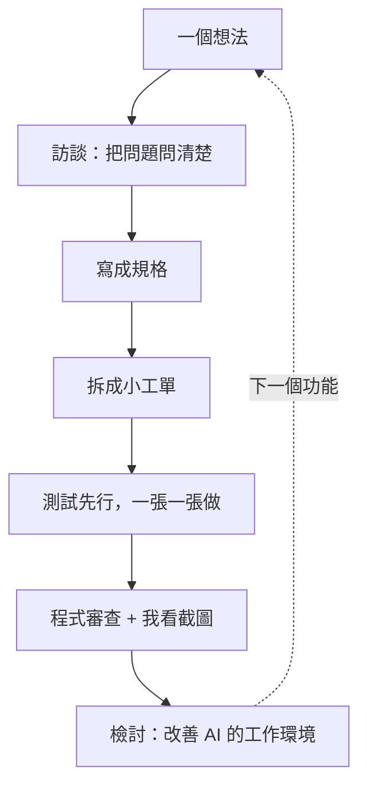

2026-11-01 凌晨 00:12，這個網站的第一個 commit；同一天晚上 22:56，最後一個。

中間這將近 23 個小時，我和 Claude Code 一起寫了 72 個 commit、合併了 37 個 pull request，從一個空資料夾，做到現在你看到的這個網站：文章頁、標籤、RSS、深色模式、自動產生的封面，還有一套讓 AI 幫我寫文章的流程。

這篇是這個網站的「創世紀」。我想說清楚的不是「AI 好厲害」，而是一套讓 AI 寫出可靠程式的工作方法：它怎麼開始、怎麼拆解、怎麼檢查，以及我在裡面扮演什麼角色。

## 網站要做什麼

先說目標。這是我的個人技術品牌網站，主要讀者是潛在的雇主和客戶，其次是工程師同行。

我給自己定了一個前提：**大部分的文字由 AI 起草，但只有我能決定什麼東西上線。** 這個前提決定了後面所有的設計。網站沒有後台，每篇文章都是一個檔案，AI 寫完開一個 pull request，我看過說 OK 才合併上線。為什麼這樣設計，我在〈[為什麼這個網站的文章寫在 git 裡](/posts/why-mdx-in-git)〉寫過，這篇專注在「怎麼蓋」。

## 工具：Matt Pocock 的 skills

Claude Code 是 Anthropic 的 AI 寫程式工具，它可以裝上「skill」：一份寫給 AI 看的工作說明書，告訴它某一類工作該怎麼做。

我用的是 TypeScript 講師 Matt Pocock 開源的 [skills](https://github.com/mattpocock/skills)。他的出發點很對我的胃口：不是讓 AI 隨興寫（他稱為 vibe coding），而是把幾十年的軟體工程習慣，拆成一個個小步驟，讓 AI 照著做。整條流程長這樣：

下面一步一步說。

## 第一步：開工前，先被問倒

我最喜歡的是第一步：**訪談**（grilling）。我丟出一個模糊的想法，AI 不急著寫程式，而是一題一題追問，直到每個決定都說清楚為止。

這個網站的第一個 commit 不是程式碼，而是訪談的產出：

- **一份詞彙表。** 例如網站上的內容叫「文章」，不叫 article、blog 或 entry；改錯字叫「勘誤」，讀者看不出來；改了讀者會學到的內容叫「改版」，要顯示更新日期；整篇拿掉叫「移除」，原網址要明確回應「已移除」，而不是「找不到」。目前詞彙表有 15 個詞，從程式碼、測試到網站上的文字，都照這份用詞。
- **三份決策紀錄。** 為什麼文章放在 git 而不是 Hashnode 或 Ghost、為什麼用 Next.js 而不是 Astro、為什麼不用現成的部落格範本。每一份都寫明當時考慮過什麼替代方案、為什麼沒選。

這一步看起來慢，其實最省時間。人和 AI 講同一套語言之後，後面幾十個 pull request 幾乎沒有因為「誤會需求」而重做。

## 第二步：把想法寫成規格，再拆成小工單

訪談完，AI 把整段對話整理成一份**規格**：問題是什麼、要怎麼解決，再從讀者和我的角度，列出 47 條「身為某某，我想要某某，好讓我某某」的需求。

接著把規格拆成**工單**。網站本體拆成 15 張，視覺設計另外一份規格拆成 6 張。每張工單都很小，而且是「從頭到尾打通」的一小段：例如第一張只做「一篇文章可以被看到」，但它從讀檔、檢查格式、到網頁顯示，整條路都要通。Matt 把這叫做「曳光彈」，先打一發看彈道對不對，再慢慢補齊。

每張工單還會寫明它要等哪幾張先做完，AI 就照這個順序施工。

## 第三步：測試先行，一張一張做

實作時，AI 用**測試驅動開發**（TDD）：先寫一個會失敗的測試，描述「這個功能該有什麼行為」，再寫剛好讓它通過的程式碼，一次只做一小步。

測試測的是「行為」，不是程式內部怎麼寫。例如「標籤不在核准清單裡，就要報錯，並說出是哪個檔案、哪個欄位」。這樣之後怎麼重構，只要行為沒變，測試就不會壞。

網站的內容規則全都是這樣寫出來的：標籤只能從核准清單挑、改網址要自動轉址、移除的文章要回應「已移除」……每一條規則都有一個「只違反這條規則」的測試範例，現在有 67 個。

## 第四步：兩種審查，加上我的截圖

一個功能做完，會經過兩道審查：

- **程式審查。** AI 開兩個獨立的子代理，一個檢查「寫法有沒有照專案規範」，一個檢查「有沒有做到規格要求的事」。分開審，是因為一段程式可能寫得很漂亮但做錯了事，也可能做對了事但寫得很亂，混在一起看容易互相掩蓋。
- **我的截圖審閱。** 我不看程式碼。AI 會把網頁在淺色、深色、手機、桌機四種情況下拍成截圖，排在同一頁，我看完說 OK，或直接說哪裡要改。

一開始我也試過每張工單開一個 PR、自己登入預覽網址一個一個看，結果太多，我反而搞不清楚該看什麼。後來改成一份規格只審一次截圖，我的工作就只剩「看」和「說 OK」。

## 第五步：每做完一張，就檢討

這是我覺得整套流程最聰明的地方：**檢討**（retro）。每做完一張工單，AI 會回頭看這段過程哪裡卡住、哪裡犯錯，然後改善的不是程式碼，而是「AI 自己的工作環境」。

原則很簡單：

- **機械性的錯誤，變成自動檢查。** 有一次，一個 pull request 不小心合併到另一個分支，而不是主線，裡面的檢查從來沒有真正上線。檢討之後，CI 多了一道關卡：pull request 的目標不是主線，就直接失敗。做視覺設計時，為了讓淺色和深色模式永遠一致，又加了一條：程式裡只要出現寫死的顏色碼，檢查就會擋下來，所有顏色都必須來自網站的色票。
- **需要判斷的事，變成寫作規範。** 例如「錯誤訊息要指出是清單裡的哪一項」「新的視覺元素都要在深色模式下檢查」，寫進專案的規範文件，之後的程式審查就會照著抓。

連我現在審閱用的截圖工具，都是檢討出來的：它會自動把網頁拍成淺色、深色、手機、桌機四張，只要畫面超出螢幕寬度就直接失敗。

那一天總共做了 8 次檢討。越後面的工單，AI 犯的錯越少，因為前面的錯誤都已經變成擋在路上的檢查了。就像交易系統要靠一次次覆盤修正參數，不是靠每次臨場的意志力。

## 長相：三輪原型挑出來的

網站的視覺不是一次決定的。AI 先做了好幾個完全不同風格的**原型**，我看完挑方向，再做下一輪，一共三輪。最後留下來的是：

- 標題用襯線字、內文用系統黑體，墨綠色的強調色，深色模式是深綠黑的底。
- 一顆寫著「溫」字的方形印章，出現在頁首、頁尾和每篇文章結尾，像簽名一樣。
- 每篇文章都有一張用網址當種子、程式畫出來的等高線封面；後來我又加上了用本機 AI 畫的水墨封面，這篇的封面就是，過程寫在〈[讓 AI 幫部落格畫封面](/posts/ai-blog-covers-svg-fooocus)〉。
- 寬螢幕上，首頁標題直排，結尾蓋上印章。

原型不會進正式的程式碼，但會保留在獨立的分支上，之後要回頭查「當初為什麼這樣設計」，有原始資料可以看。

## 寫文章：AI 學我的口氣

網站蓋好，最後一步是讓 AI 幫我寫文章。我給了三段自己寫的文字當範例，AI 從裡面整理出我的寫作習慣，寫成一份寫文章用的 skill：

- **三種文風。** 技術文是「硬核實戰派」，從完成的結果切入，再拆解架構和取捨；職涯和投資是「生活沉澱派」，從一個生活小場景出發；旅行和家庭是「感性紀實派」。
- **具體的數字和名字。** 不寫「花了一段時間」，要寫「花了 1 個月」；能從程式碼和紀錄查證的，就用查得到的事實。
- **不編造。** AI 查不到的個人細節，像「當時的感受」「花了多久」，一律列在 pull request 的「請 Owner 確認」，由我逐條確認，不會自己編。

AI 寫完會跑過所有檢查、產生社群用的文宣圖、拍好截圖，再開成草稿 PR。我說 OK，它合併，網站一兩分鐘後更新。你現在讀的這篇，就是這樣產生的。

## 接下來

回頭看這一天，我覺得最大的收穫不是「一天做完一個網站」，而是這套流程本身：先被問倒再動手、把大事拆小、讓測試說話、每次犯錯都變成下一次的護欄。這些都不是 AI 時代才有的新觀念，只是現在可以讓 AI 照著做，而且做得很徹底。

下一步，我要把互動的 AI Demo 放進這個網站。到時候，這套流程會再跑一次：從一個想法開始，先被問倒。
