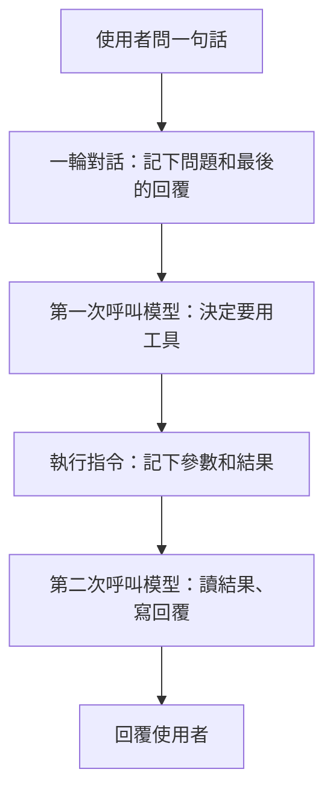

接上 Langfuse 只花了不到一個小時。接下來的半天，我都在修它畫錯的東西。

Langfuse 是一套開源的 AI 監控工具：AI agent 每想一步、每用一次工具、每花一分錢，它都記下來，畫成一頁頁看得懂的紀錄。我把它接到自己寫的 agent「kai」上，程式跑得好好的，測試全過，連一個錯誤訊息都沒有。打開網頁一看，對話頁面一片空白；修好之後，37 輪對話散成了 33 段；再修好，成本算得比實際貴；最後我塞了一把假金鑰進去測遮罩，AI 在思考的時候把它原封不動抄了一遍，遮罩沒攔到。

監控工具本身不會告訴你它記錯了……這篇拆解這 9 次修正，每一次都是一個「畫面看起來沒問題，其實是錯的」，以及最後定下來、改程式時不能退回去的設計決定。

## 為什麼 agent 需要監控

[kai](https://github.com/duncan-wen/kai) 是我用 Python 寫的終端機 AI agent：用講的就能操作系統、一句話生出專業分身、接上各種 MCP 工具。問它一句話，它背後可能呼叫三次模型、跑兩個指令、再把工作交給另一個分身。

問題是，這些過程我都看不到。它答錯了，我不知道是哪一步想歪；它變慢了，我不知道是模型慢還是工具慢；月底帳單來了，我也說不出是哪段對話最花錢。

Langfuse 把一輪對話記成一棵樹，叫做 trace。kai 的一輪對話長這樣：



每次呼叫模型，Langfuse 記下用了哪個模型、送了什麼、回了什麼、花了多少 token、第一個字多久才出來；每次用工具，記下參數和結果。同一段對話的每一輪，再用同一個 session ID 串起來，Langfuse 的 [Sessions](https://langfuse.com/docs/observability/features/sessions) 頁面就能把整段對話像聊天紀錄一樣重播。

## 接上它：沒設金鑰就什麼都不做

kai 是開源專案，大部分使用者不會用 Langfuse，所以第一個設計決定是：**沒設金鑰，就完全不存在**。

- Langfuse 的套件是選配的，要另外安裝，一般使用者少裝約 10 個套件（OpenTelemetry 整套、protobuf 等）。
- 第一次用到時才初始化。沒設金鑰、沒裝套件，或初始化失敗，就回傳「什麼都不做」的空殼，程式其他地方不用寫任何 `if`。
- 設了金鑰卻沒裝套件，印一行提示，不讓程式當掉。

埋點的地方只有四種，用 Python 的 `with` 包起來：

```python
with trace(name="chat-turn", input=user_message(text)) as span:
    ...  # 這一輪裡面的模型呼叫、工具呼叫，會自動掛在底下
    span.update(output=assistant_message(reply))
```

一輪對話是 `trace`，呼叫模型是 `generation`，用工具是 `tool`，把工作交給另一個分身是 `agent`。這四個對應到 Langfuse 官方的[觀測類型](https://langfuse.com/docs/observability/features/observation-types)，分清楚之後，Langfuse 才畫得出哪一步是模型在想、哪一步是工具在做。

到這裡不到一個小時，程式通了，紀錄也上去了。

## 第一次：對話頁面一片空白

紀錄有上去，Sessions 頁面卻什麼都沒顯示。

原因有兩層。第一層，我記下的格式是 `{"user": "..."}`，Langfuse 的對話頁面只認 `{"role": "user", "content": "..."}` 這種標準的聊天訊息格式。改了，還是空白。

第二層更隱蔽：單一一則訊息不夠，**要包成陣列**。Langfuse 看到陣列，才會當成一段對話畫成聊天泡泡；看到單獨一個物件，就當成一般資料顯示原始內容。

```python
def user_message(text: str) -> list[dict]:
    return [{"role": "user", "content": text}]  # 一定要是陣列
```

同一次修正還抓到一個情況：kai 把工作交給分身時，分身那一輪對話會被掛在主 agent 那一輪的底下，變成子節點，而對話頁面只讀最上層的問與答，所以又是一片空白。解法是每一輪對話開始前，先切斷外層的追蹤脈絡，強制它自己當一棵新的樹。

## 第二次：37 輪對話散成 33 段

對話頁面終於有東西了，但對話被拆得七零八落：我實際測了 37 輪對話，Langfuse 把它們記成了 33 個 session，幾乎每一輪都自成一段。

session ID 要能代表「同一段對話」，而且整段對話期間不能變。我原本用對話紀錄檔的建立時間當 ID，在 Python 裡讀的是 `st_ctime`。問題是 Linux 上的 `st_ctime` 不是建立時間，是**最後一次變更時間**。kai 每輪對話結束都會存檔，每存一次，ID 就變一次：

```python
import time
from pathlib import Path

history = Path("history.json")
history.write_text("[]")
for turn in range(1, 4):
    time.sleep(1.1)
    history.write_text(f'[{{"turn": {turn}}}]')  # 每輪對話結束都存一次
    session_id = int(history.stat().st_ctime)
    print(f"第 {turn} 輪的 session ID：{session_id}")
```

在 Linux 上跑，每一輪都拿到不同的 ID（數字是當下的時間，每次跑都不一樣）：

```text
第 1 輪的 session ID：1795531633
第 2 輪的 session ID：1795531634
第 3 輪的 session ID：1795531635
```

那用對話的名字當 ID 呢？也不行：中途改名，一段對話會被切成兩段；兩段對話取了同一個名字，又會被併成一段。

最後的做法是第一次需要時產生一個 `kai-YYYYMMDD-HHMMSS-xxxx` 的 ID，存成檔案，之後整段對話都讀它。把對話封存時一起記下來，叫回舊對話時還原，Langfuse 裡就能接著原本那一段繼續。名字改放在附加資訊裡，想找命名過的對話照樣篩得到。

## 第三次：用了工具的那幾輪，被拆成「No messages」

ID 對了，又出現新問題：只要那一輪用了工具，就被拆成好幾個寫著「No messages」的空對話。

Langfuse 串對話的方式，是看**後一次呼叫模型時送出的內容，有沒有包含前面的訊息**。而我為了省空間，每次只記最後 6 則訊息，還把「模型要求呼叫哪個工具」和「工具結果對應哪次呼叫」這兩個欄位丟掉了。對 Langfuse 來說，前後兩次呼叫看起來毫無關係。

這次修正定下了幾條規則：

1. 每次呼叫模型，記下的輸入要完整重複前面的對話，不能只留尾巴。
2. 工具呼叫和工具結果的對應編號要保留。kai 支援本機模型 Ollama，而它的工具呼叫沒有編號，就用「工具名稱 + 參數 + 位置」算出一個固定的雜湊當編號，前後兩次才對得上。
3. 同一則訊息，在這次的輸出和下次的輸入裡，要截成一模一樣的長度（統一 2,000 字）。
4. 同一輪裡第二次以後的模型呼叫，不放 system prompt 的佔位文字，否則畫面上會像是對話中途有人插進一段系統指令。

同一批還修了一個：對話紀錄存滿之後，kai 會刪掉最舊的訊息，總長度不變，而我是用「這一輪開始時的長度」去找這一輪的回覆，索引就落空了。結果是長對話之後，每一輪記下的回覆都是空的；我手上那筆紀錄呼叫了 24 次模型，最上層的回覆卻是空字串。改成直接用「這一輪使用者那則訊息本身」去定位，只看它後面的回覆。

## 第四次：成本算貴了

我用的 DeepSeek 會快取重複的輸入，命中快取的部分比一般輸入便宜很多。但它回報的輸入 token 數，是**含快取命中的總數**。

我照原樣交給 Langfuse，Langfuse 就把全部當一般輸入計價。官方的[成本文件](https://langfuse.com/docs/observability/features/token-and-cost-tracking)寫得很清楚：各種 token 是互斥的桶子，`input` 不包含 `input_cached_tokens`。所以要自己拆開，總數減掉快取命中的部分才是一般輸入，各自用各自的價格算。

同一次稽核還補上了：工具失敗時標成錯誤等級，在 Langfuse 一篩就找得到；模型呼叫一律叫 `generate-response`，不帶模型或後端的名字，換模型時，篩選條件和之後要做的自動評分才不會跟著失效。

## 漏掉的金鑰：AI 在思考時把它抄了一遍

監控工具會把 agent 看到的一切都傳上雲端，包括工具的輸出。kai 能執行 shell 指令，只要模型跑一次 `cat .env`，裡面的 API 金鑰就跟著上傳了。

Langfuse 的 Python SDK 可以傳入一個[遮罩函式](https://langfuse.com/docs/observability/features/masking)，所有要上傳的內容先經過它。kai 的遮罩分兩層：

1. 工具參數裡，欄位名含 key、secret、token、password 的值，一律換成 `***`。
2. 所有上傳內容裡，環境變數中金鑰的原值、常見的憑證格式（`sk-…`、`ghp_…`、`Bearer …` 等），以及 `XXX_API_KEY=…` 這種寫法的值，也都換掉。

為了驗證，我在對話裡塞了一把假的 `DEMO_API_KEY`，再把紀錄抓回來看。使用者的輸入遮了，工具輸出也遮了……模型的思考卻漏了。它在思考時寫了一句「這個值看起來像是測試用的假值」，把金鑰的值單獨引用出來，前面沒有 `DEMO_API_KEY=`，規則就認不出來。

修法是讓遮罩「記住」它認出來的值：從賦值裡抓到的值存在記憶體裡，之後在任何地方單獨出現都一起遮掉。下面用一個縮小的版本示範兩版的差別：

```python
import re

MASK = "***"
ASSIGNMENT = re.compile(r"(\b[A-Z0-9_]*API_KEY\s*=\s*)([^\s\"']{4,})")
learned: set[str] = set()


def mask_v1(text: str) -> str:
    """第一版：只認得 XXX_API_KEY=… 這種寫法。"""
    return ASSIGNMENT.sub(lambda m: m.group(1) + MASK, text)


def mask_v2(text: str) -> str:
    """第二版：認出來的值記住，之後單獨出現也遮。"""
    for m in ASSIGNMENT.finditer(text):
        learned.add(m.group(2))
    for value in learned:
        text = text.replace(value, MASK)
    return ASSIGNMENT.sub(lambda m: m.group(1) + MASK, text)


tool_output = "DEMO_API_KEY=abc12345secret"
thinking = '"abc12345secret" 看起來像是測試用的假值'

print("第一版")
print("  工具輸出：", mask_v1(tool_output))
print("  模型思考：", mask_v1(thinking))
print("第二版")
print("  工具輸出：", mask_v2(tool_output))
print("  模型思考：", mask_v2(thinking))
```

```text
第一版
  工具輸出： DEMO_API_KEY=***
  模型思考： "abc12345secret" 看起來像是測試用的假值
第二版
  工具輸出： DEMO_API_KEY=***
  模型思考： "***" 看起來像是測試用的假值
```

真正的版本多了幾個限制：太短的值不記（避免把一般的字遮掉），最多記 1,000 筆，而且遮罩本身出錯時，整段換成 `***`，寧可什麼都看不到，也不讓原文送出去。

<Callout title="遮罩只是盡力而為">

規則再多，也攔不下所有寫法。kai 的安全說明直接寫明這一點，也把 system prompt 的上傳做成可以整個關掉：它可能帶著專案的記憶內容，每輪只在第一次呼叫模型時記一份，同時記一個雜湊指紋，不看內容也能知道 system prompt 換過版本沒有。

</Callout>

## 這些 bug 是怎麼抓到的

回頭看這 9 次修正，沒有一次是程式報錯、測試失敗抓到的。單元測試從頭到尾都是綠的，因為測試只能驗證「我以為對的格式」，驗證不了「Langfuse 畫出來的樣子」。

抓到它們的方式只有一種：**把真實的紀錄抓回來看**。每改完一次，就實際跟 kai 聊幾輪，再從 Langfuse 把那幾筆紀錄抓下來，一項一項對：類型對不對、思考有沒有記到、token 和成本對不對、樹的層次對不對、金鑰有沒有遮掉。Langfuse 官方給 AI 用的 [skill](https://github.com/langfuse/skills) 把這一步列為必做：剛產生的紀錄要重新抓回來，對照官方的建議做法逐項檢查，有缺就修，修完再跑、再抓，直到全部對上。這 9 次修正，就是這樣一輪一輪跑出來的。

反過來，測試也差點污染了監控。有一個測試會真的跑一輪對話，而我的 `.env` 裡有真的金鑰，測試裡的假對話就這樣被送上雲端，混進統計裡。所以測試啟動時一律清空 Langfuse 的金鑰：監控只看真的使用，測試只測程式。

## 下一步

監控工具接上的那一刻，畫面上什麼都有，很容易以為事情做完了。但它記下的東西，跟任何程式的輸出一樣，需要驗收……而且它不會自己喊錯。

如果你也在幫 agent 接監控，最划算的一件事，是接好之後馬上跟它聊幾輪，把紀錄打開，用眼睛對一遍：對話有沒有串成一段、成本對不對得上帳單、塞一把假金鑰進去，看它會不會從哪個角落漏出去。

還有一個提醒：kai 用的那個遮罩參數，Langfuse 官方文件現在已經標為舊版，新專案建議改用 `mask_otel_spans`。官方的建議做法會變，所以那份 skill 才要求每次稽核都重新讀一次，不能憑記憶……監控要驗收，驗收的標準本身也要定期回頭看。
