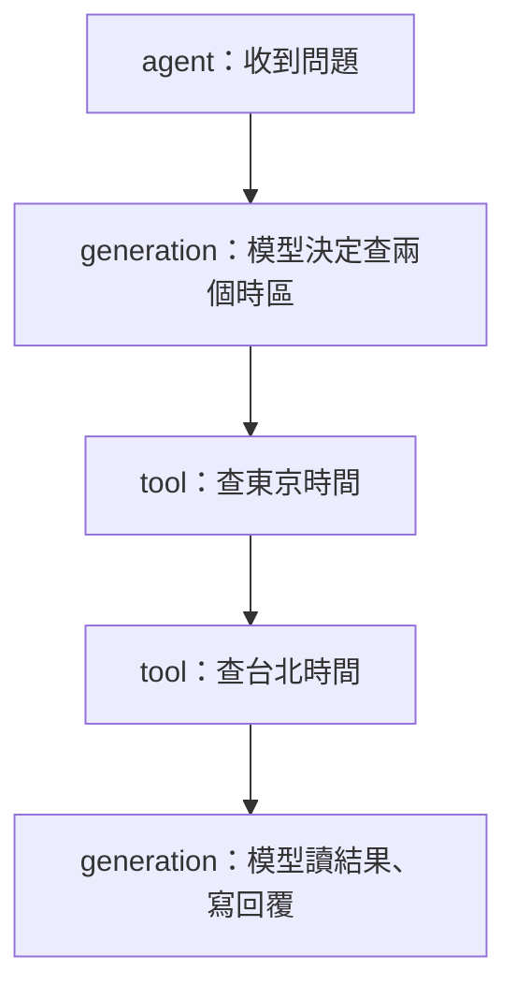
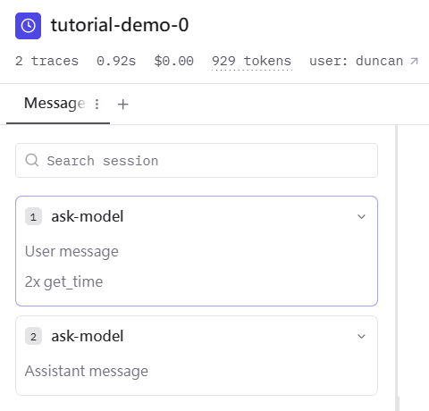
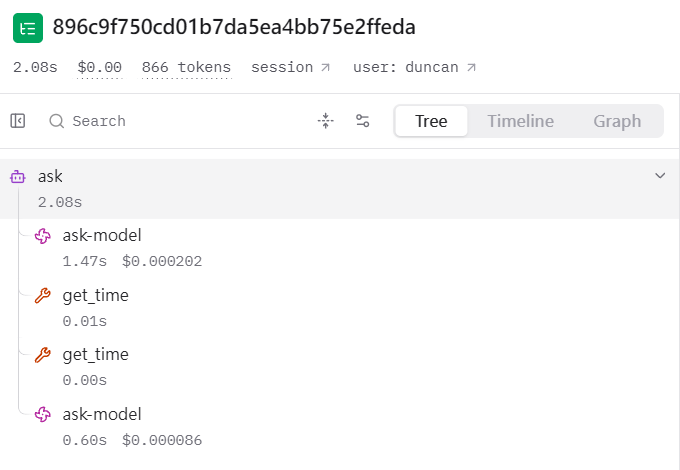
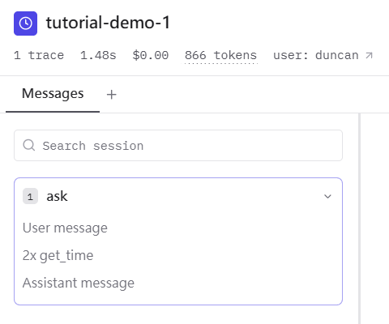

我問 AI：「東京和台北現在差幾小時？」它回了一句「東京比台北快 1 小時」。看起來只是一問一答……其實它背後呼叫了 2 次模型、跑了 2 次查時間的工具，用了 866 個 token，花了 0.00029 美元。

這些數字，原本都藏在程式裡看不到。這篇用 Python 寫一個會用工具的小 AI agent，再一步一步接上開源監控工具 [Langfuse](https://langfuse.com/docs)，三個步驟：

1. 改一行 import，每次呼叫模型都被記下來。
2. 加兩個裝飾器，把一整輪問答串成一棵樹。
3. 包一層 session，同一段對話的每一輪排在一起。

跟著做大約 15 分鐘，需要一個 Langfuse 帳號（有免費方案）和一把模型的 API 金鑰。範例用 DeepSeek，換成 OpenAI 或任何相容 OpenAI 格式的模型都一樣。

## Langfuse 記下什麼

一個 AI agent 回答一個問題，通常不只呼叫一次模型。模型先決定要用哪個工具，程式去執行工具，再把結果交回模型，模型讀完才寫出回覆。中間任何一步出錯、變慢、變貴，從最後那句回覆都看不出來。

Langfuse 把一輪問答記成一棵樹，叫做 **trace**。樹上每個節點叫 **observation**，常見的有三種：

- **generation**：一次模型呼叫。記下送了什麼、回了什麼、用了多少 token、花了多少錢、多久才回。
- **tool**：一次工具呼叫。記下參數和結果。
- **agent**：負責決定下一步的那段程式，通常是樹根。

我們要做出來的，就是這樣一棵樹：



## 準備：金鑰和套件

先到 [Langfuse Cloud](https://langfuse.com/cloud) 註冊、建一個專案，在專案的 Settings → API Keys 產生一組金鑰。資料中心有美國、歐盟、日本可以選，網址不一樣，選哪裡就用哪個網址。

把金鑰設成環境變數：

```bash
export LANGFUSE_PUBLIC_KEY="pk-lf-..."
export LANGFUSE_SECRET_KEY="sk-lf-..."
export LANGFUSE_BASE_URL="https://cloud.langfuse.com"   # 美國用 us.cloud，日本用 jp.cloud
export LANGFUSE_TRACING_ENVIRONMENT="tutorial"           # 練習的資料標成 tutorial，之後好篩掉
export DEEPSEEK_API_KEY="sk-..."
```

`LANGFUSE_TRACING_ENVIRONMENT` 不是必填，但很值得設：同一個專案裡，練習、開發、正式的資料就能用 [environment](https://langfuse.com/docs/observability/features/environments) 分開看，不會混在一起。

安裝套件。這篇用的是 Langfuse Python SDK 5.2.0：

```bash
pip install langfuse openai
```

## 完整程式

先看完整的程式，下面再一段一段拆：

```python
import json
import os
from datetime import datetime
from zoneinfo import ZoneInfo

from langfuse import get_client, observe, propagate_attributes
from langfuse.openai import OpenAI  # 唯一要改的一行：原本是 from openai import OpenAI

client = OpenAI(
    api_key=os.environ["DEEPSEEK_API_KEY"],
    base_url="https://api.deepseek.com",
)

TOOLS = [
    {
        "type": "function",
        "function": {
            "name": "get_time",
            "description": "查詢某個時區現在的時間",
            "parameters": {
                "type": "object",
                "properties": {
                    "timezone": {"type": "string", "description": "例如 Asia/Taipei"}
                },
                "required": ["timezone"],
            },
        },
    }
]


@observe(as_type="tool")
def get_time(timezone: str) -> str:
    return datetime.now(ZoneInfo(timezone)).strftime("%Y-%m-%d %H:%M")


@observe(as_type="agent")
def ask(question: str) -> str:
    messages = [{"role": "user", "content": question}]
    while True:
        reply = client.chat.completions.create(
            name="ask-model",
            model="deepseek-v4-flash",
            messages=messages,
            tools=TOOLS,
            tool_choice="auto",
        ).choices[0].message
        if not reply.tool_calls:
            return reply.content
        messages.append(reply)
        for call in reply.tool_calls:
            args = json.loads(call.function.arguments)
            messages.append(
                {
                    "role": "tool",
                    "tool_call_id": call.id,
                    "content": get_time(**args),
                }
            )


with propagate_attributes(session_id="tutorial-demo-1", user_id="duncan"):
    print(ask("東京和台北現在差幾小時？"))

get_client().flush()
```

存成 `agent.py`，執行 `python agent.py`，終端機印出模型的回覆。模型每次措辭不同，時間也是你執行當下的時間：

```text
東京現在比台北快 **1 小時**（東京 02:23、台北 01:23）。
```

終端機看起來跟沒接 Langfuse 一模一樣。差別在 Langfuse 那一邊。

## 第一步：改一行 import

```python
from langfuse.openai import OpenAI  # 原本是 from openai import OpenAI
```

Langfuse 包了一層 [OpenAI 的 Python SDK](https://langfuse.com/integrations/model-providers/openai-py)，用法完全一樣，只是每次呼叫都會順手記一筆 generation：送出的訊息、模型的回覆、token 數、成本、延遲。

`create()` 多出來的 `name="ask-model"` 是 Langfuse 加的參數，幫這次呼叫取個名字，在網頁上好找。不給也能跑。

只做這一步就停下來，Langfuse 上會看到什麼？我實際試了：**兩筆各自獨立的紀錄**。第一筆是模型決定要查時間，第二筆是模型寫回覆，兩筆之間沒有關係。



上圖為了方便對照，先包了第三步的 session，兩筆才排在同一頁。第一筆底下的「2x get_time」是模型**要求**呼叫工具，寫在它的回覆裡；工具實際跑了沒、拿到什麼、花多久，Langfuse 都沒有記到。

對只呼叫一次模型的程式，這樣就夠了。對 agent 來說，還差一步。

## 第二步：兩個 `@observe`，串成一棵樹

```python
@observe(as_type="tool")
def get_time(timezone: str) -> str: ...


@observe(as_type="agent")
def ask(question: str) -> str: ...
```

[`@observe`](https://langfuse.com/docs/observability/sdk/instrumentation) 是 Langfuse 的裝飾器，加在函式上，函式每跑一次就記一個節點，參數當輸入、回傳值當輸出。

關鍵在**巢狀**：`ask()` 執行期間發生的模型呼叫和 `get_time()`，都會自動掛在 `ask` 底下。不用傳任何 ID，Langfuse 靠目前執行到哪一層來判斷父子關係。

`as_type` 告訴 Langfuse 這是哪一種[節點](https://langfuse.com/docs/observability/features/observation-types)。不填預設是一般的 span，也能用；分清楚之後，網頁上看得出哪一步是模型在想、哪一步是工具在做。

加完這兩行，剛剛那兩筆零散的紀錄，就變成文章開頭那棵樹：一個 `ask` 底下，依序是兩次 `ask-model` 和兩次 `get_time`。



每個節點旁邊直接標了耗時，模型呼叫還多了成本。在網頁上點任何一個節點，旁邊就會打開它的輸入和輸出。

## 第三步：session，把對話排在一起

```python
with propagate_attributes(session_id="tutorial-demo-1", user_id="duncan"):
    print(ask("東京和台北現在差幾小時？"))
```

一棵樹是一輪問答。聊天機器人會連續問答好幾輪，每輪都是一棵新的樹，要讓 Langfuse 知道它們屬於同一段對話，就給同一個 [session ID](https://langfuse.com/docs/observability/features/sessions)。

`propagate_attributes` 會把 `session_id` 和 `user_id` 傳給裡面產生的每一個節點。之後在 Langfuse 的 Sessions 頁面，同一個 session 的每一輪會依序排好，像聊天紀錄一樣重播；也能依使用者篩選，看某個人的所有對話。



跟第一步那張比：一樣問一句，原本是兩筆零散的 `ask-model`，現在是一筆完整的 `ask`，問題、工具、回覆都在裡面。這段範例只問了一輪；多問幾輪，下面就會一輪一輪接下去。

session ID 要能代表「同一段對話」，整段對話期間都不能變。實際的聊天程式裡，通常在對話開始時產生一個，存起來，之後每一輪都用它。

## 最後一行：`flush()`

```python
get_client().flush()
```

Langfuse 是在背景批次上傳的，不會拖慢你的程式。代價是：像這種跑完就結束的腳本，最後幾筆可能還在排隊，程式就關了。結束前呼叫 `flush()`，等它全部送出。長時間執行的服務，在關閉前呼叫一次就好。

## 在 Langfuse 上看到的數字

我把這次執行的紀錄抓回來，整理成表。數字每次執行都會有些不同：

| 節點 | 類型 | token（輸入 / 輸出） | 成本（美元） | 耗時 |
| --- | --- | --- | --- | --- |
| ask | agent | — | — | 2.08 秒 |
| ask-model（第 1 次） | generation | 310 / 74 | 0.000202 | 1.47 秒 |
| get_time | tool | — | — | 0.008 秒 |
| get_time | tool | — | — | 0.001 秒 |
| ask-model（第 2 次） | generation | 185＋快取 256 / 24 | 0.000086 | 0.60 秒 |

幾件從回覆裡看不出來的事，這張表一眼就看得出來：

- **時間都花在模型上。** 2.08 秒裡，兩次模型呼叫佔了 2.07 秒，工具不到 0.01 秒。要加速，該動的是模型，不是工具。
- **模型一次就叫了兩個工具。** 第一次呼叫就決定同時查東京和台北，沒有多繞一圈。
- **第二次呼叫有 256 個 token 命中快取。** 第二次送出的訊息，開頭和第一次一樣，DeepSeek 快取了這段，算比較便宜的價格。Langfuse 把快取的部分分開計價，不用自己算。

成本是 Langfuse 依它內建的模型價目表自動算的，不用自己查價格；用到它沒有內建的模型時，可以在專案設定裡自己加價格。

## 接下來可以做的事

到這裡，你的 agent 每一輪在做什麼、花多少、慢在哪，都看得到了。接下來可以試試：

- 把你自己的 agent 換上這三步：改 import、在主迴圈和每個工具加 `@observe`、包一層 session。
- 故意讓工具出錯一次，打開那筆紀錄，看失敗的那一步長什麼樣子。
- 跑個十幾輪，到 Langfuse 的儀表板看每天的 token 用量和成本曲線。

監控接好之後，記得回頭打開一筆紀錄，用眼睛對一遍：樹的層次對不對、session 有沒有串成一段、成本對不對得上帳單。Langfuse 只會照你給它的資料畫……畫錯了，它不會告訴你。
