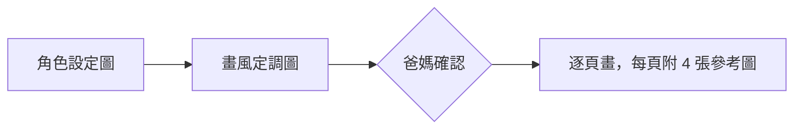
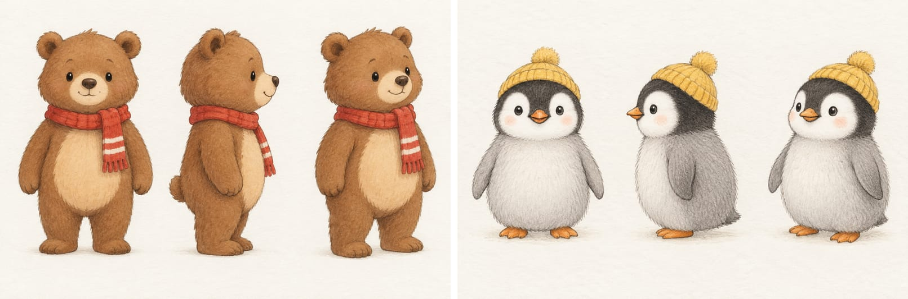
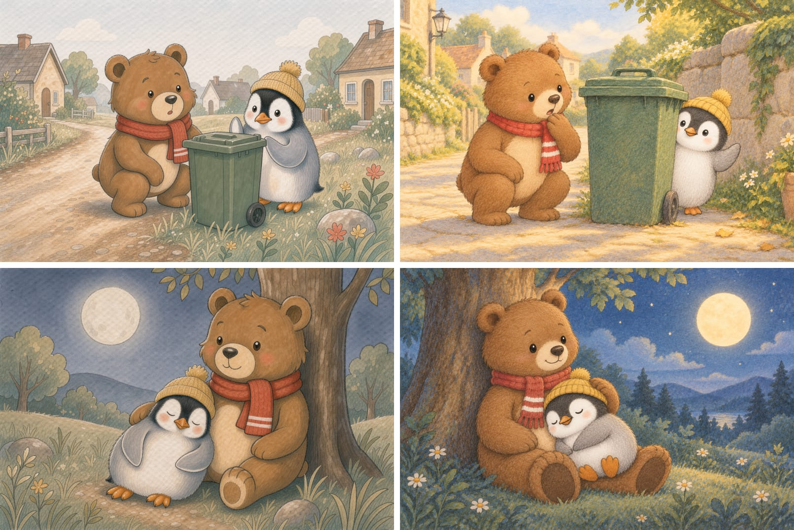
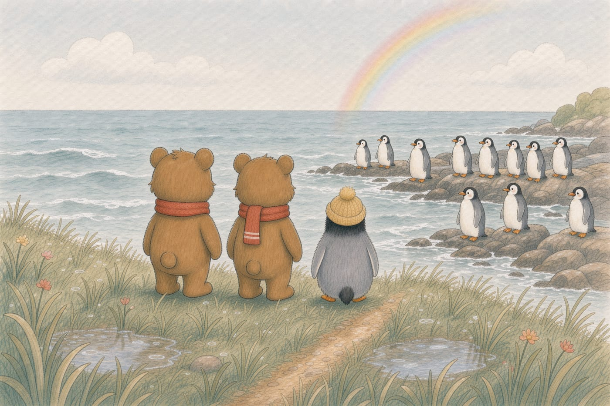
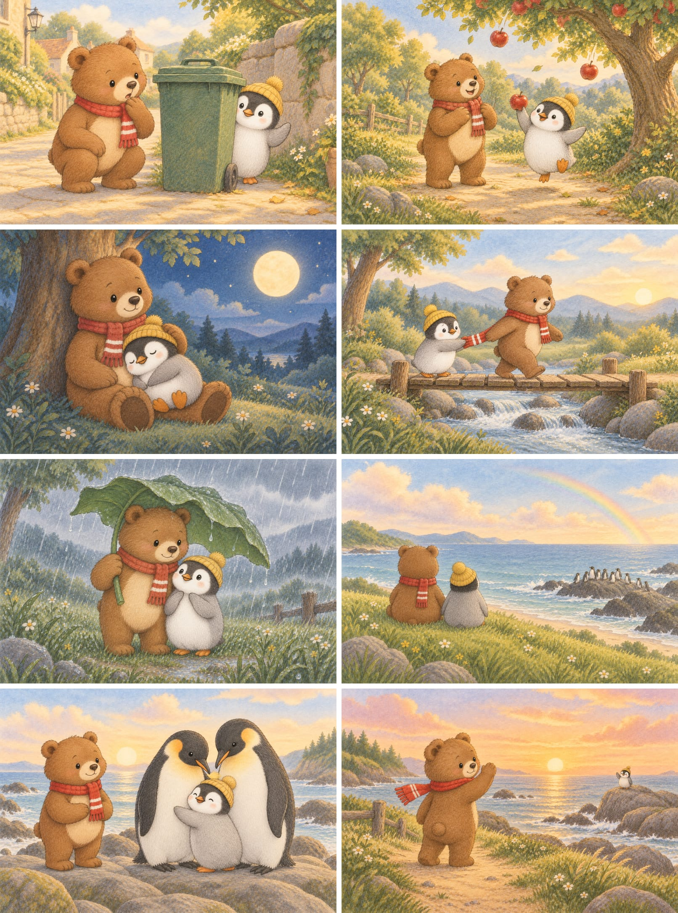

螢幕上並排著兩本一模一樣的繪本，一本標著「方案 A」，一本標著「方案 B」。同一個故事，兩家 AI 各畫一遍，名字蓋住了，我不知道哪一本是誰畫的。

我一頁一頁往下對，盯著小熊阿布脖子上那條紅圍巾。白天、森林、月夜、下雨、海邊……圍巾還在，臉也還是同一張臉。兩本都是。

我最擔心的事沒有發生。可是答案一揭曉，我事前排在第一位的那一家，輸了。

## 繪本最怕主角變臉

[上一篇](/posts/voice-clone-bedtime-story)講的是聲音：我在做一個小專案，爸媽錄一段聲音、寫個故事大綱，AI 就做出一本有插圖的繪本，用爸媽自己的聲音唸給小孩聽。聲音那一關過了，這一篇輪到插圖。

請 AI 畫一張漂亮的圖，現在不是難事。難的是畫一整本。

AI 每畫一張圖，都像是第一次聽到這個故事。上一頁的小熊是深咖啡色、圍著紅圍巾，下一頁可能毛色淡了、圍巾不見了，甚至換了一張臉。大人看了也許只覺得怪怪的，可是聽故事的孩子，眼睛是一直黏在主角身上的。

所以這一關的問題很單純：同一隻小熊，從第一頁到最後一頁，能不能都是同一隻？

## 還沒開始畫，先刷掉一家

動手之前，我先把市面上做得到的幾家查了一遍，剩下三個候選。

第一個出局的是 Google。論技術它其實最強，可以同時記住好幾個角色。但它的使用條款寫明，不能用在以未滿 18 歲的人為對象的服務上。繪本就是做給小孩看的，沒得商量。

剩下兩家：Black Forest Labs 的 FLUX，和 OpenAI 的 GPT Image。光看資料，我把 FLUX 排在第一：它一次可以參考 10 張圖，而且參考圖不另外收錢。OpenAI 則是在自己的官方文件裡就先承認了，「重複出現的角色可能不一致」。連它自己都這樣說，我只把它當備選。

不過到底誰畫得一致，沒有哪一份資料可以告訴我。只能讓兩家各畫一本，用眼睛看。

## 先幫主角拍一張定裝照

直接叫 AI「畫第一頁」「畫第二頁」，主角一定會跑掉。我用的做法，跟動畫公司開工前先畫角色設定圖是同一個道理：

1. **先畫角色設定圖。** 每個角色一張，正面、側面都有。阿布是一隻圓滾滾的小棕熊，圍著有兩條白線的紅圍巾；圓圓是一隻小企鵝，戴著有毛球的黃色毛線帽。
2. **再畫一張畫風定調圖。** 讓兩個角色站在同一個場景裡，定下整本書的顏色和筆觸。
3. **這三張先給爸媽看過。** 不滿意就重畫，滿意了才往下走。
4. **一頁一頁畫。** 每畫一頁，都把 4 張圖交給 AI 當參考：兩張角色設定圖、畫風定調圖，還有剛畫好的上一頁。

下面是其中一家畫出來的兩張設定圖：

這裡有一個我刻意守住的決定：角色全部用文字描述出來，不上傳任何照片。主角長什麼樣子，用寫的就夠了，孩子的照片不需要離開家裡。

## 一本專門用來考 AI 的故事

故事用的還是上一篇那隻迷路的企鵝，我把它從 3 頁加長到 8 頁，而且每一頁都故意換一種考法：

- 白天的小巷、森林、月夜、大雨、海邊、夕陽，光線和顏色一直換；
- 有貼得很近的特寫，也有人物小小的遠景；
- 有一頁只看得到兩個主角的背影；
- 有一頁海邊站了一大群企鵝，看 AI 會不會把圓圓跟別的企鵝搞混。

兩家用同一份故事、同一份角色描述、同一套流程各畫一本。然後跟上次盲聽聲音一樣，我做了一個評分網頁：兩本書並排，只標「方案 A」和「方案 B」，全部打完分數才揭曉誰是誰。

## 兩本書的小熊，都沒有變臉

結果出乎我的意料。角色像不像同一隻、畫風有沒有跑掉，兩家我都給了滿分。

| 評分項目（1 到 5 分） | FLUX | GPT Image |
|---|---|---|
| 阿布每一頁都是同一隻 | 5 | 5 |
| 圓圓每一頁都是同一隻 | 5 | 5 |
| 整本畫風一致 | 5 | 5 |
| 單張圖畫得好不好 | 3 | 5 |
| 願意拿給小孩看 | 5 | 5 |

OpenAI 自己擔心的「重複角色可能不一致」，在這本書裡一次都沒有發生。月夜那一頁整個畫面變成深藍色，下雨那一頁灰濛濛的，阿布的紅圍巾和圓圓的黃帽子都還在。

我想功勞不在哪一家特別厲害，而在那張定裝照：每一頁都有同樣的參考圖可以對，AI 就不用憑印象重畫一次主角。

下面是同樣的兩頁，左邊是 FLUX，右邊是 GPT Image：

## 分出高下的，是畫得好不好看

兩邊的主角都沒走樣，差別在別的地方。

FLUX 的圖，我在評分時寫下的是「色系暗暗的」「有點簡陋的場景」。畫風定調圖我請它重畫過一次，整本看下來還是偏灰、背景偏空，單張品質只給了 3 分。GPT Image 的光線和細節豐富得多，拿了 5 分。

而且 FLUX 有一頁出了錯。就是看背影的那一頁……沙丘上站了兩隻阿布。

臉沒變，卻多了一隻。這種錯，孩子大概比我還早發現。

其他幾項也都倒向同一邊：

- **速度。** 一張圖 FLUX 通常要 37 秒左右，GPT Image 大約 25 秒。
- **價錢。** 三張設定圖加 8 頁，FLUX 花了大約 0.77 美元，GPT Image 照官方牌價算大約 0.53 美元。我原本看上 FLUX 的「參考圖不另外收錢」，實際算下來並沒有比較便宜。
- **條款。** 跟上一篇選聲音時一樣，這是最硬的一條。OpenAI 預設不拿我送進去的東西訓練模型；FLUX 的服務條款則是讓它對送進去和畫出來的圖，都拿到永久的使用授權，包含拿去訓練。

所以最後選的是原本的備選 GPT Image，FLUX 留著當後備。

## 選定之後，才看到的兩件事

實際跑過一遍，有兩件事是查資料時沒想到的，都會改到產品的設計。

第一件，那三張設定圖一定要在開始畫故事之前就確認好。每一頁都是照著它們畫的，等整本畫完才嫌小熊不可愛，就只能整本重來。

第二件，要等。一頁要二、三十秒，而且每一頁都得參考上一頁，沒辦法 8 頁同時畫，只能排隊一頁一頁來。一本 12 頁的繪本，大概要等 5 到 7 分鐘。所以畫面上得有個進度，讓爸媽知道現在畫到第幾頁，可以先去泡杯茶。

這是最後選定的那一本，8 頁全部：

## 資料只能幫我刷掉誰，不能幫我選誰

回頭看，查資料這一步有它的用處：Google 那一家，就是靠讀條款刷掉的，一張圖都不用畫。可是剩下兩家誰比較好，資料給我的排名剛好是反的。真正的答案，是把兩本書並排、蓋住名字，一頁一頁看出來的。

當然，這只是我一個人的眼睛、一本 8 頁的故事，樣本很小。換一種畫風、換一個故事，結果也許不一樣。

不過那張定裝照的做法，不寫程式也用得上。如果你也想請 AI 畫一套前後連貫的圖，不管是給孩子的小故事，還是自己的貼圖角色，可以先做一件事：請它畫一張角色設定圖，畫到滿意為止；之後每畫一張，都把這張設定圖一起附上去，跟它說「照這個角色畫」。

主角有了定裝照，才不會每翻一頁，就換一個人演。
