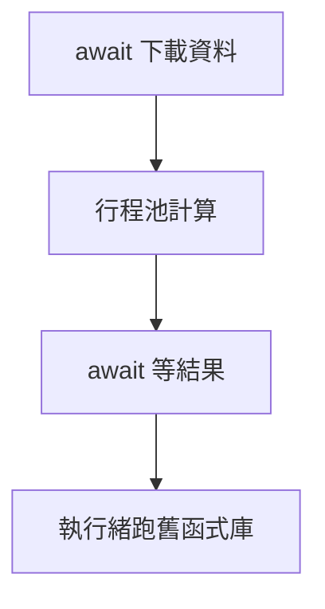

4 條執行緒跑了 1.82 秒，比依序執行的 1.74 秒還慢；換成 4 個行程，只要 0.49 秒。

為了把觀念真正弄清楚，我把 Python 的 multiprocessing、threading、asyncio 放在同一台 8 核心的電腦上，用同一份程式各跑了一遍。以前背過的答案是「CPU 密集用 multiprocessing，I/O 密集用 threading 或 asyncio」，但真正看到數字的那一刻，才明白這句話背後在說什麼。這篇文章把概念、實測、選用時機和整合寫法整理在一起，被追問「為什麼」的時候，也答得出來。

## 先分清楚：工作卡在哪裡

選擇之前，先問一個問題：這份工作慢，是因為 CPU 一直在算，還是因為一直在等？

- **CPU 密集**：影像處理、加解密、數值計算、解析大檔案。時間花在 CPU 上，要快就得同時用到更多顆核心，也就是**平行**（parallelism）。
- **I/O 密集**：呼叫 API、查資料庫、讀寫檔案、爬網頁。時間花在等待回應，CPU 大多閒著，要快就得在等的時候去處理別件事，也就是**並行**（concurrency）。

並行不一定同時在算，平行才是真的同時在算。這組名詞很容易混在一起，先把它們分開，後面的選擇就順了。

## 三種模型長什麼樣


關鍵在中間那把 **GIL**（Global Interpreter Lock，全域直譯器鎖）。CPython 為了讓記憶體管理簡單又安全，規定同一個行程裡，同一時間只有一條執行緒能執行 Python 位元組碼。

用廚房來想會比較好記：

- **multiprocessing** 是多開幾間廚房，每間都有自己的食材和刀具，可以真的同時開火，代價是開廚房很貴，食材要搬來搬去。
- **threading** 是一間廚房裡站了好幾位廚師，食材共用，但只有一把刀（GIL）。輪到誰誰切，切菜時其他人只能等；不過有人在等水滾的時候，會先把刀放下。
- **asyncio** 是只有一位廚師，水在燒的時候，他自己決定先去切菜。切換時機寫在程式裡，就是每個 `await`。

## CPU 密集：為什麼多開執行緒反而沒變快

用一個純計算的函式，數出 20 萬以內有幾個質數，各跑 4 次。程式存成 `cpu_bound.py`，後面整合時還會用到：

```python
import time
from concurrent.futures import ProcessPoolExecutor, ThreadPoolExecutor


def count_primes(limit: int) -> int:
    """純計算：數出 limit 以內有幾個質數，整段時間都在用 CPU。"""
    count = 0
    for n in range(2, limit):
        if all(n % d for d in range(2, int(n**0.5) + 1)):
            count += 1
    return count


def timed(label, run):
    start = time.perf_counter()
    run()
    print(f"{label:<10}{time.perf_counter() - start:.2f} 秒")


if __name__ == "__main__":
    jobs = [200_000] * 4

    timed("依序執行", lambda: [count_primes(n) for n in jobs])
    with ThreadPoolExecutor(max_workers=4) as pool:
        timed("4 條執行緒", lambda: list(pool.map(count_primes, jobs)))
    with ProcessPoolExecutor(max_workers=4) as pool:
        timed("4 個行程", lambda: list(pool.map(count_primes, jobs)))
```

在我的電腦上（Python 3.11，8 核心）跑出來是這樣：

```text
依序執行      1.74 秒
4 條執行緒    1.82 秒
4 個行程     0.49 秒
```


執行緒版本沒有變快，反而因為要搶 GIL、切換執行緒，多花了一點時間。行程版本每個行程都有自己的直譯器和 GIL，4 顆核心同時算，大約快了 3.5 倍。沒有剛好 4 倍，是因為啟動行程、把參數和結果在行程之間傳遞（pickle 序列化）都有成本。

<Callout title="注意">

用 multiprocessing 時，啟動程式碼要放在 `if __name__ == "__main__":` 裡面。Windows 和 macOS 預設用 spawn 啟動子行程，子行程會重新 import 主程式；沒有這個保護的話，會一直遞迴開新行程。

</Callout>

## I/O 密集：重點是一起等

換成模擬 10 次網路請求，每次等 0.5 秒，CPU 幾乎沒事做（`io_bound.py`）：

```python
import asyncio
import time
from concurrent.futures import ThreadPoolExecutor


def fetch(i: int) -> int:
    """模擬一次網路請求：0.5 秒都在等回應，CPU 幾乎沒事做。"""
    time.sleep(0.5)
    return i


async def fetch_async(i: int) -> int:
    await asyncio.sleep(0.5)  # 等待時把控制權交還給事件迴圈
    return i


def timed(label, run):
    start = time.perf_counter()
    run()
    print(f"{label:<10}{time.perf_counter() - start:.2f} 秒")


async def main_async():
    return await asyncio.gather(*(fetch_async(i) for i in range(10)))


if __name__ == "__main__":
    timed("依序執行", lambda: [fetch(i) for i in range(10)])
    with ThreadPoolExecutor(max_workers=10) as pool:
        timed("10 條執行緒", lambda: list(pool.map(fetch, range(10))))
    timed("asyncio", lambda: asyncio.run(main_async()))
```

```text
依序執行      5.02 秒
10 條執行緒   0.51 秒
asyncio   0.52 秒
```


這次執行緒有用了。執行緒在等 I/O 的時候會釋放 GIL，其他執行緒就能接著發出自己的請求，大家一起等，總時間就接近最慢的那一個。asyncio 用一條執行緒做到一樣的效果。

兩者都能做到一起等，差別在**誰決定什麼時候切換**：

| | threading | asyncio |
| --- | --- | --- |
| 切換方式 | 作業系統搶占式切換，隨時可能被切走 | 協作式切換，只在 `await` 讓出 |
| 每個單位的成本 | 一條執行緒有自己的堆疊，開幾千條就吃力 | 一個任務只是一個物件，開上萬個也輕鬆 |
| 函式庫 | 一般的同步函式庫都能用（`requests`） | 要用支援 async 的函式庫（`httpx`、`aiohttp`） |
| 最大的坑 | 共用資料會有 race condition | 一個沒有 `await` 的阻塞呼叫，會卡住整個事件迴圈 |

asyncio 的那個坑值得多講一句：在 `async def` 裡呼叫 `time.sleep(5)` 或同步的 `requests.get()`，事件迴圈會整個停 5 秒，其他任務全都動不了。協作式切換的前提，是每個任務都願意讓出。

## 共用記憶體的代價：race condition

執行緒共用記憶體，傳資料很方便，但兩條執行緒同時改同一個變數時，結果就不可靠。下面讓 4 條執行緒各把計數器加 10,000 次，在讀和寫之間用 `time.sleep(0)` 模擬做了點別的事：

```python
import threading
import time

counter = 0
lock = threading.Lock()


def add(times: int, use_lock: bool) -> None:
    global counter
    for _ in range(times):
        if use_lock:
            with lock:
                counter += 1
        else:
            value = counter      # 讀
            time.sleep(0)        # 模擬中間做了點別的事，讓出 GIL
            counter = value + 1  # 寫：別人可能已經改過了


for use_lock in (False, True):
    counter = 0
    threads = [threading.Thread(target=add, args=(10_000, use_lock)) for _ in range(4)]
    for t in threads:
        t.start()
    for t in threads:
        t.join()
    print(f"{'有 Lock' if use_lock else '沒 Lock'}：{counter:,}（應該是 40,000）")
```

```text
沒 Lock：10,000（應該是 40,000）
有 Lock：40,000（應該是 40,000）
```

沒有 Lock 的版本，四分之三的加法都被覆蓋掉了。這也回答了一個常見的誤解：**有 GIL 不代表執行緒安全**。GIL 只保證一次只有一條執行緒跑位元組碼，但「讀、改、寫」是好幾個步驟，中間隨時可能被切走。

行程就沒有這個問題，因為它們根本不共用記憶體；反過來說，資料要用 `multiprocessing.Queue` 或回傳值傳遞，而且傳的東西要能被 pickle 序列化。

## 何時選用哪一個

選擇其實只要問兩個問題：

1. **它一直在算嗎？** 是的話，用 multiprocessing。
2. **如果是在等 I/O，連線多嗎？** 上百、上千條連線，而且有 async 版本的函式庫，用 asyncio；數量不多，或手上只有同步的 SDK，用 threading。

兩種工作都有的程式，就把它拆開，各自回答一次這兩個問題，下一節的整合寫法就是這樣來的。

| 情境 | 選擇 | 原因 |
| --- | --- | --- |
| 影像縮圖、數值計算、大量解析 | multiprocessing | 繞過 GIL，用滿多核心 |
| 爬幾十個網頁、呼叫既有的同步 SDK | threading | 寫法直覺，等待時會釋放 GIL |
| 上千個 WebSocket、高併發 API 服務 | asyncio | 任務輕量，切換時機可預測 |
| 先抓資料再做大量計算 | 組合使用 | 各自做自己擅長的事 |

## 整合運用：asyncio 當主幹

真實的程式很少只有一種工作。常見的情境是先從網路抓一批資料，對每筆做一段重計算，最後寫進一個只有同步版本的舊函式庫。這時可以讓 asyncio 當主幹，把不適合它的工作交出去，下面的範例存成 `combined.py`：

- I/O 用 `await`，在事件迴圈裡一起等；
- CPU 密集的計算用 `loop.run_in_executor` 交給 `ProcessPoolExecutor`；
- 只有同步版本的阻塞呼叫用 `asyncio.to_thread` 丟給執行緒，不卡住事件迴圈。



```python
import asyncio
import time
from concurrent.futures import ProcessPoolExecutor

from cpu_bound import count_primes  # 前面 CPU 密集範例裡的函式


async def download(i: int) -> int:
    """I/O：用 asyncio 同時等很多個請求。"""
    await asyncio.sleep(0.5)
    return 200_000


def save_report(results: list[int]) -> None:
    """只有同步版本的舊函式庫：會卡住，丟給執行緒。"""
    time.sleep(0.5)


async def main() -> None:
    loop = asyncio.get_running_loop()
    with ProcessPoolExecutor(max_workers=4) as pool:
        limits = await asyncio.gather(*(download(i) for i in range(4)))
        results = await asyncio.gather(
            *(loop.run_in_executor(pool, count_primes, n) for n in limits)
        )
        await asyncio.to_thread(save_report, results)
    print(results)


if __name__ == "__main__":
    start = time.perf_counter()
    asyncio.run(main())
    print(f"總共 {time.perf_counter() - start:.2f} 秒")
```

```text
[17984, 17984, 17984, 17984]
總共 1.52 秒
```

1.52 秒剛好可以拆成三段：4 個下載一起等的 0.5 秒、4 個行程同時計算的 0.5 秒、寫報表的 0.5 秒。如果全部依序執行，光下載就要 2 秒，計算 1.74 秒，加起來超過 4 秒。

## 檢查自己懂了沒的幾題

- **GIL 是什麼？為什麼有它？** CPython 的全域鎖，讓參考計數這類記憶體管理不必處處加鎖。代價是同一行程內的 Python 程式碼無法平行執行。
- **為什麼 I/O 密集用執行緒還是有效？** 因為執行緒在等 I/O 時會釋放 GIL。
- **有 GIL 還需要 Lock 嗎？** 需要。GIL 不保護「讀、改、寫」這類多步驟操作。
- **asyncio 比執行緒快嗎？** 不一定比較快，但在大量連線時更省資源，切換時機也更可預測。
- **在 async 函式裡呼叫阻塞函式會怎樣？** 整個事件迴圈被卡住。要改用 async 版本，或用 `asyncio.to_thread` 交出去。
- **行程之間怎麼溝通？** 用 `Queue`、`Pipe` 或執行器的回傳值，資料必須能被 pickle 序列化。

<Callout title="補充">

Python 3.13 開始提供實驗性的 free-threaded 版本，可以拿掉 GIL，到了 3.14 已經是正式支援、但仍需另外安裝的版本。這是語言未來的走向；不過預設的 CPython 還是有 GIL，上面的結論在日常工作中依然成立。

</Callout>

把這三個放在一起實測過一次之後，我發現與其背「CPU 用行程、I/O 用執行緒」，不如記住一個問題：**這份工作卡在哪裡？**……答得出這題，選擇就跟著出來了。
