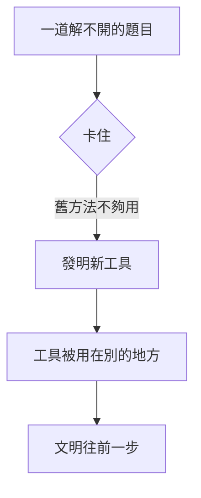

這個禮拜，黎曼猜想被證明了兩次。

一次是數學家 Levent Alpöge 和 AI 模型 Claude 一起完成的；另一次，是史丹佛的博士後研究員 Alessandro Masullo 一個人花了 12 年寫出來的。兩份證明都還在等其他數學家檢驗，但看著這兩則新聞並排出現，我想到的不是誰先誰後，而是一件更根本的事：人類的文明，是在解題的過程裡進步的……而 AI，把這段過程大幅省略了。

## 167 年沒人解開的題目

黎曼猜想是德國數學家黎曼在 1859 年提出的，談的是質數。質數看起來毫無規律地散落在整數之間，黎曼猜測，它們的分布底下其實藏著一個精確的結構。

這個猜想是千禧年大獎難題的七題之一，每題懸賞 100 萬美元。規則很嚴格：證明要公開發表，再經過至少兩年的檢驗，得到全世界數學界普遍接受，才算數。這七題設立二十多年來，正式被解決的只有一題。

## 同一週，兩份證明

[The Verge 的報導](https://www.theverge.com/ai-artificial-intelligence/1010051/anthropic-riemann-hypothesis-millennium-prize-problem)寫到，Alpöge 在 Anthropic 工作，他宣布和 Claude 一起證明了黎曼猜想，還說同樣的方法能推得更遠。證明用 Lean 寫成：Lean 是一種讓電腦逐步驗算數學證明的語言，每一步都要對得上，電腦才會通過。

他在[自己的聲明](https://simonwillison.net/2026/Nov/20/levent-alpoge/)裡寫了一段很動人的話：

> 很自然會覺得這是一個終點，對我來說，是失去了一盞主要的指路明燈。

他從小就著迷這個問題。追了大半輩子的燈，一夕之間熄了。

同一週，美國數學學會會長、史丹佛教授 Ravi Vakil [提前公開了 Masullo 的證明](https://simonwillison.net/2026/Nov/20/ravi-vakil/)，證明的是範圍更大、涵蓋原本黎曼猜想的「廣義黎曼猜想」。Vakil 特別註明：「全部是人類完成的，沒有用 AI。」他們原本打算讓 Masullo 到史丹佛待一年，把文字打磨好、讓夠多人看過再發表，現在只好先把草稿放出來。

[TechCrunch 的報導](https://techcrunch.com/2026/11/20/ai-claimed-a-solution-to-the-167-year-old-riemann-hypothesis-and-a-human-did-too/)引了 Masullo 寫在證明開頭的一段話，是寫給被這波 AI 浪潮弄得灰心的數學家：

> 我們還在。我們好好地活著。我們哪裡都不去。

## 解不出來的那幾百年，人類順手發明了很多東西

要說清楚為什麼「過程」重要，我想先講另一道題目。

1637 年左右，法國數學家費馬在一本書的頁邊寫下一個猜想，還附了一句：我想到了一個絕妙的證明，可惜這裡空白太小，寫不下。接下來三百五十多年，一代又一代的數學家試著補上這個證明，全都失敗了。

但失敗並沒有白費。十九世紀，德國數學家庫默爾在嘗試證明它的時候，發現原本的數字系統不夠用，於是發明了「理想數」，這個概念後來發展成整個代數數論的基礎。到了 1994 年，英國數學家懷爾斯終於完成證明，他一路走過的橢圓曲線、模形式，又變成後來許多研究的起點。

費馬最後定理本身，在日常生活裡幾乎派不上用場；真正改變數學的，是人類為了解它，一路發明出來的那些工具。

黎曼猜想也一樣。數學家 Chris Birkbeck 在討論區拆解 Alpöge 的證明時，列出它用到的東西：伽羅瓦表示、自守表示、基變換……一長串名字，每一個都是數學家這幾十年、上百年來，在解其他難題的路上發明出來的工具。

換句話說，這份和 AI 一起完成的證明，是站在人類一路「解不出來」所累積的工具上。

## AI 省掉的，正是長出工具的那一段

AI 給答案的方式不一樣。Alpöge 描述他和 Claude 一起摸索的過程，說到了最後衝刺，是 Claude 遠遠跑在他前面。人類花幾十年卡住、繞路、被逼著發明新概念的那一段，被壓縮成幾個月的對話；AI 把現有的工具飛快地組合起來，直接走到終點。

Alpöge 自己也承認，這份證明還沒有一份人類讀得懂的說明。結果有了，電腦也驗算過了，但「為什麼會成立」，還沒有人能用人話講清楚，他承諾接下來會去補上。TechCrunch 的記者說得很直白：要讓這一切有意義，還得等人類真正看懂它，再解釋給彼此聽。

我是寫程式的人，對這件事有一點切身的感受。以前用一個不熟的套件，要翻文件、找範例、踩過幾次坑，才知道它為什麼這樣設計；現在把需求說清楚，AI 直接給出寫法。省下的時間是真的，但那段踩坑的過程，也一起被省掉了。

解題的過程，從來不只是通往答案的路。卡住的那些時刻，才是新工具誕生的地方。當答案可以直接拿到，這段過程就很容易被跳過；而跳過的，可能正是下一個「理想數」出現的機會。

## 下一個工具，會從哪裡來

Masullo 說「我們還在」，我不覺得那只是不服輸。他花的那 12 年，留下的不只是一份證明，還有一個人一路走過、真正弄懂的路徑，以及途中可能長出來的新想法。

AI 會越來越常直接給我們答案，這擋不住，也不必擋。只是下一次 AI 幫我把題目解完，我想多問一句：這條路，有沒有哪一段值得我自己再走一遍？
