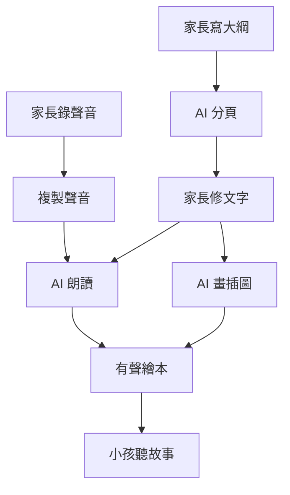

同一家 AI、同一個人、同樣四段文字，只是錄樣本時換了口氣：用平常講話的語氣錄，AI 唸繪本「適合講故事」只拿 2.7 分；改用哄小孩睡覺的語氣錄，同一家拿到 4.0 分。

AI 學走的不只是我的音色，連講話的口氣也一起學走了。

這是我最近在做的一個小專案：爸媽錄一段聲音、寫個故事大綱，AI 就會做出一本有插圖的繪本，用爸媽自己的聲音唸給小孩聽，平板上一頁一頁翻過去，字跟著聲音亮起來。加班晚歸、出差在外的晚上，小孩還是能聽到熟悉的聲音說「晚安」。

現在還在原型階段。我沒有急著寫產品程式碼，而是先把「這件事做不做得起來」拆成幾個問題，一題一題用研究和拋棄式的原型回答。這篇整理目前學到、值得記下來的東西。

## 這個 App 長什麼樣子

整條流程分成兩端：大人準備故事，小孩只負責聽。

聽起來很順，但每個箭頭背後都有一個「可能做不起來」的問題：

1. 複製出來的聲音，夠不夠像爸媽、夠不夠像在講故事？
2. 一本書七、八頁的插圖，主角能不能每頁都長得一樣？
3. 手機和平板的瀏覽器，能不能順順地播聲音、翻頁、離線聽？
4. 錄的是大人的聲音、聽的是小孩，法規上要注意什麼？

每一題我都先查資料比較方案，最關鍵的第一題，再做一個盲聽原型，用自己的耳朵驗證。

## 盲聽怎麼做

我先用手機在安靜的房間錄了兩種東西：

- **樣本**：四段日常短文，例如「今天天氣很好，我們全家一起去公園散步」，總共約 1 分鐘，給 AI 學我的聲音。
- **真人對照**：一本三頁的小繪本，用我平常唸給小孩聽的方式唸，等一下要混在 AI 的版本裡。

繪本的文字是故意設計過的。小熊阿布在垃圾桶旁邊遇到一隻迷路的企鵝，裡面藏了好幾個台灣和大陸唸法不同的字：星期、垃圾、企鵝、「我和你」的和；還有「喔」「啦」這種語助詞、「咚、咚、咚！」的狀聲詞、角色對話，最後一頁是睡前的悄悄話「晚安，圓圓。晚安，阿布。」

接著寫了一個小網頁當試聽台：每一頁把真人和兩個 AI 版本打亂順序，音量全部校正成一樣，開頭結尾的靜音也切掉，不讓任何一段因為「比較大聲」或「停頓比較長」露餡。每段打三個分數，1 到 5 分：

- **像本人**：聽起來是不是我。
- **發音**：台灣腔對不對。
- **適合講故事**：小孩會不會想聽下去。

再加一個按鈕「我猜這段是真人」，全部打完才揭曉答案。

## 發現一：AI 連口氣都學走

第一輪，我用平常講話的口氣錄樣本，拿 Fish Audio 的免費模型複製，並比較「用完整 1 分鐘樣本」和「只用其中一段、約 15 秒」：

| 來源 | 像本人 | 發音 | 適合講故事 |
|---|---|---|---|
| 真人錄音 | 5.0 | 5.0 | 4.0 |
| AI，1 分鐘樣本 | 3.3 | 4.7 | 2.7 |
| AI，15 秒樣本 | 3.0 | 3.3 | 2.0 |

樣本只剩 15 秒，每一項都往下掉。原本我還想像過「讓奶奶隨口錄幾句就好」……看來至少要 1 分鐘。

但更讓我在意的是「適合講故事」那一欄。AI 的聲音確實是我，可是唸起繪本來平平的，像在念公告。我回頭想：它學的那 1 分鐘，本來就是我平常講話的樣子。

所以第二輪，我把同樣四段文字重錄一次，這次用講睡前故事的口氣：放慢、放軟、該停的地方停一下。其他條件全部不變，只有口氣不同：

| 來源 | 像本人 | 發音 | 適合講故事 |
|---|---|---|---|
| 真人錄音 | 5.0 | 5.0 | 5.0 |
| AI，講故事口氣的樣本 | 4.0 | 4.0 | 3.3 |
| AI，平常口氣的樣本 | 3.7 | 3.7 | 2.7 |

同一家、同一個人、同樣的字，只差在錄音時的口氣，「適合講故事」就從 2.7 拉到 3.3，第三輪再測同一份樣本更到了 4.0。這一輪還有一頁，我把 AI 的版本猜成了真人。

這個發現直接改寫了產品的錄音流程：給家長的錄音說明，重點不是「請在安靜的地方錄」，而是「請用你唸故事給孩子聽的口氣錄」。

## 發現二：最像我的那一家，我沒選

第三輪，兩家 AI 用同一份講故事口氣的樣本正面對決：Fish Audio，和 ElevenLabs 的 `eleven_v4`。

| 來源 | 像本人 | 發音 | 適合講故事 | 被我當成真人 |
|---|---|---|---|---|
| 真人錄音 | 5.0 | 5.0 | 5.0 | 3 頁中 3 頁 |
| Fish Audio | **4.7** | 5.0 | 4.0 | 3 頁中 1 頁 |
| ElevenLabs | 4.0 | 5.0 | **5.0** | 3 頁中 0 頁 |

Fish 更像我。有一頁連續兩輪，我都把它當成真人。ElevenLabs 則一次都沒騙過我，可是三頁的「適合講故事」全部 5 分。差距最大的是第一頁企鵝「小小聲地說」那段悄悄話：ElevenLabs 5 分，Fish 只有 3 分。

最後我選了 ElevenLabs，理由有三個：

1. **小孩要的是故事，不是驗明正身。** 這個 App 的核心是把故事講好，聲音像到 4 分已經認得出是爸爸，講故事從 4 分到 5 分的差別，小孩反而聽得出來。
2. **穩定。** Fish 同一份樣本，第二輪「適合講故事」3.3 分，第三輪 4.0 分，起伏很大；ElevenLabs 三頁都穩穩的。
3. **條款。** 這是最硬的一條。Fish 的使用條款允許平台拿上傳的內容去訓練模型，沒有退出的選項，刪了帳號還「可能無法完全刪除」。我自己的聲音還好，但這個 App 之後要給朋友的家庭用，別人爸媽的聲音，不能交給一個不保證刪得掉的地方。

台灣華語的讀音反而是我最擔心、結果最不用擔心的部分：星期、垃圾、企鵝、和，兩家在最後一輪都拿到滿分，不用額外修正。

另外，ElevenLabs 免費方案不能複製聲音，API 會直接回 `paid_plan_required`，至少要付費的入門方案。

## 發現三：逐字時間戳，讓字跟著聲音亮

繪本裡「唸到哪個字，哪個字就亮起來」，聽起來是前端的事，其實要靠語音 API 配合：它得告訴我每個字是在第幾秒唸的。

兩家都有提供這種逐字時間戳 (timestamps)。ElevenLabs 連標點符號都算一個字回傳，三頁分別切成 54、62、71 段，剛好等於每頁的總字數，前端只要照著時間把對應的字標起來就好。

有了這個，我做了第二個原型：播放器。同一本小熊阿布，用真的 AI 聲音和時間戳，做了三種玩法讓小孩試：

- **繪本跨頁、自動翻**：橫向攤開，左圖右文，唸完自動翻頁。
- **看圖聽、字幕條**：整個螢幕都是圖，字像卡拉 OK 一樣在下方填色，一路播到底。
- **我來翻、點字重聽**：小孩用手指拖著翻頁，點一句話就再唸一次。

要觀察的是：小孩第一次拿到，會先點、先滑，還是先拖？他想自己控制節奏，還是只想放空聽？他到底會不會看那些亮起來的字？這些答案，決定字要放在頁面上、當字幕，還是乾脆預設藏起來。

## 其他研究裡踩到的坑

不是每個問題都需要原型，有些查資料就有答案，而且答案常常出乎意料：

- **iPhone 不讓網頁自己出聲。** 每次打開故事，都要小孩先點一下「開始聽」，而且必須在那一下點擊裡直接開始播放，不能先下載完再播。所以整本書只用同一個播放元件、每頁換音檔，才能沿用第一次點擊拿到的播放權。
- **加到主畫面的網頁 App，在 iOS 鎖螢幕後播完一段就停住**，這是 WebKit 至今沒修的 bug。我的解法是讓螢幕在聽故事時保持亮著。
- **畫插圖的 AI，有一家直接出局**：Google 的 Nano Banana 條款禁止用在 18 歲以下會使用的服務。最後首選 BFL 的 FLUX 3，一次能帶 10 張參考圖，讓主角每一頁都長同一個樣子，一本書的插圖成本約 1 到 1.4 美元。
- **小孩端什麼都不蒐集。** 小孩沒有帳號、不輸入任何資料；錄音的家長則要在錄之前明確同意，並留下紀錄。

## 這次學到的

回頭看這幾輪盲聽，最大的收穫不是選出哪一家，而是發現 AI 複製的是「那一刻的你」：你用什麼心情錄，它就用什麼心情講。

這件事放到任何「用範例教 AI」的場景都成立……給它看什麼樣子，它就學成什麼樣子。

當然，這只是我一個人的耳朵、三頁故事，樣本很小。下一步是把三種播放器拿給小孩實際玩，看他的手指先往哪裡去，再試著讓 AI 畫出一整本主角不變臉的插圖。如果你手邊也有想用 AI 做給家人的小東西，不妨先做一個盲聽或盲測，自己的耳朵和眼睛，常常比規格表誠實。
