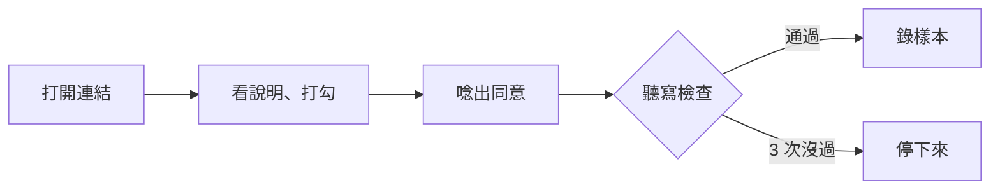

打開你的 LINE，往上滑一滑，找一則家人傳來的語音訊息。媽媽問你週末回不回家吃飯的那種。

[第一篇](/posts/voice-clone-bedtime-story)裡，我只錄了大約 1 分鐘，AI 就學會了我的聲音，像到我自己都把它猜成真人。而我選的那家聲音服務，在建立一個聲音的時候只要求一件事：打一個勾，聲明你有權利使用這段錄音。

沒有人檢查錄音裡的那個人，是不是打勾的那個人。

也就是說，手機裡那幾則語音訊息湊一湊，就夠讓 AI 用那個人的聲音說話了……而我正準備請朋友的家庭來試用，開始收別人爸媽的聲音。

## 自己的聲音隨便玩，別人的不行

先交代一下前情：我在做一個小專案，爸媽錄一段聲音、寫個故事大綱，AI 就做出一本有插圖的繪本，用爸媽自己的聲音唸給小孩聽。前兩篇解決了聲音像不像、[主角會不會變臉](/posts/picture-book-character-consistency)，用的都是我自己的聲音、我自己編的小熊。

拿自己的聲音做實驗，出了事也是我自己的事。可是這個 App 接下來要給幾個朋友的家庭試用，唸故事的人會是別人家的爸爸、媽媽，甚至奶奶。

所以在寫任何一行程式之前，我先去讀了法規。先說清楚：我不是律師，下面是我自己讀條文整理出來的理解，不是法律意見。

讀完之後，有三件事跟我原本想的不一樣：

- **只有自己家用，法律不管；一邀請朋友，就管了。** 台灣的[個人資料保護法](https://law.moj.gov.tw/LawClass/LawAll.aspx?pcode=I0050021)不適用於單純的個人或家庭活動，可是這個例外只包到自己家。朋友的家庭一加入，我就是法律上蒐集個資的那一方，不收錢、只是小小的試用也一樣。
- **聲音在法律上不算最敏感的那一類。** 法條列出的特別敏感資料是病歷、基因、健康檢查這些，聲音不在裡面。所以法律沒有要求白紙黑字的書面同意，只要求兩件事：先把該講的講清楚，再取得當事人同意；而且日後有爭議，要由我來證明對方同意過。
- **同意，要本人給。** 這一條最容易漏掉。媳婦可以幫奶奶下載 App、幫她按錄音鍵，但不能幫她說「我同意」。奶奶就算沒有帳號、不會登入，那一句同意也得是她自己給的。

## 法律要的是一個勾，我覺得不夠

照法律的最低要求，其實一個勾就夠了：畫面上列出告知事項，奶奶勾「我同意」，我把時間記下來。

可是聲音跟地址、電話不一樣。電話號碼外流了，可以換一支；聲音被複製了，別人就能用它說出任何話，而你沒辦法換一副嗓子。

再加上開頭說的那件事：我用的這種快速複製，聲音服務那一端不驗證本人，只要我這邊打勾聲明就放行。它其實另有一種比較費工的方案，會要求本人唸一句驗證用的句子，但我這個 App 用的不是那一種。

所以「確認是本人、而且本人願意」這件事，沒有人會幫我把關，只能由我的 App 自己來。我要擋的是兩種情況：

1. 有人拿一段現成的錄音來，錄音裡的人根本不知情；
2. 本人確實在場，但沒搞清楚自己答應了什麼。

## 奶奶收到一條連結

最後定下來的流程是這樣的。我用奶奶當例子，因為她是最難的情況：沒有帳號、不想裝東西、手機只會用 LINE。

家裡負責管理的那個人，在 App 裡填上「奶奶」，App 就產生一條錄音連結，讓家人傳給奶奶。奶奶點開之後：

1. **先看說明。** 這段聲音要拿來做什麼、會送到哪一家公司、放在哪個國家、之後怎麼刪，寫成一頁白話。
2. **勾選同意。**
3. **開口唸一句話。** 「我是〇〇，我同意用我的聲音為家人唸故事」，後面接著畫面上的 3 個詞。這 3 個詞每一次都是隨機抽的。
4. **機器把這句話聽寫出來**，檢查有沒有唸到名字和那 3 個詞。沒對上就重唸，最多 3 次；3 次都沒過，流程就停下來，請家裡的管理者跟我聯絡。
5. **接著錄 4 段短文**，加起來大約 1 分鐘，這才是給 AI 學的樣本。

這裡面有三個決定，是專門用來擋那兩種情況的。

**不能上傳音檔，只能當場用麥克風錄。** 這是最乾脆的一刀。App 裡根本沒有「選擇檔案」這個按鈕，手機裡存了誰的語音訊息都派不上用場。

**同意要唸出來，而且帶著隨機的詞。** 一段舊錄音裡，不會剛好有今天畫面上抽到的那 3 個詞。而「我同意用我的聲音為家人唸故事」這句話從自己嘴裡說出來，比手指滑過去按一個勾，更難說成「我不知道我答應了什麼」。這段同意的錄音，也就是我日後要拿得出來的證明。

**同意和樣本，要在同一次裡一口氣錄完。** 不能今天唸同意、明天再補樣本。連結也只能用一次，7 天沒用就失效。

家裡的管理者自己要當唸故事的人，也是走同一套，沒有後門。

## 我決定先不做的那一件事

這套流程有一個洞，我自己知道：我沒有讓機器去比對，唸同意的聲音和後面那 4 段樣本，是不是同一個人。

也就是說，如果有人存心要騙，自己唸完同意，再把手機遞給旁邊的人唸樣本，機器是擋不住的。我也沒辦法確定點開連結的真的是奶奶，所以說明頁上會直接寫明：拿到這條連結的人，就視為奶奶本人。

為什麼先不做？因為試用階段是邀請制，進來的每一個家庭我都認識，會這樣大費周章騙我的人，不在名單上。而且拿聲音來辨認「這是不是同一個人」，跟拿聲音來唸故事是兩回事：在有些地方的法規裡，前者會被算成更敏感的一類資料。

同意紀錄我也刻意少存：只留同意的錄音、當時看的是哪一版說明、勾選的時間、是誰邀請的。連線位址和手機的識別資料都不存。

這是一個取捨，不是忘記。等到要開放給不認識的人，這一關要重新評估。

## 敢收，是因為還得回去

確認本人只是前半。對一個把聲音交出來的人來說，更要緊的是後半：這個聲音之後會被拿去做什麼？我反悔了怎麼辦？

**它只能唸這個家的繪本。** App 裡沒有一個「打什麼字，就用奶奶的聲音唸出來」的輸入框。聲音只會唸這個家庭自己做的繪本裡的每一頁。奶奶不用一本一本審，但說明裡會寫清楚：家裡的管理者可以用你的聲音，唸他們做的故事。

**一個家庭一份，不共用。** 同一位奶奶要幫兩個孫子、兩個家庭唸，就是各同意一次、各錄一次。這一家的人，叫不動她在那一家的聲音。

**奶奶自己就能刪。** 錄完的那一頁會給她一條長期有效的「管理我的聲音」連結，可以試聽 AI 學成什麼樣子，也可以直接刪掉，不用登入，更不用開口拜託誰。家裡的管理者也能刪，再不行還有我的信箱，30 天內處理完。

**刪，就是全部刪。** 包括：

- 聲音服務那一端建立的聲音；
- 她當初錄的原始樣本；
- 所有用她的聲音唸出來的音檔，連孩子平板上為了離線收聽存下來的那些，也會在下次連上網路時清掉。

繪本的文字和插圖會留著，換一個人的聲音就能重新唸。唯一留下來的是那筆同意紀錄，保留到聲音刪除後 1 年，因為「她當初同意過」這件事，法律要我舉證。

這也是為什麼[第一篇](/posts/voice-clone-bedtime-story)選聲音服務的時候，條款是最硬的一條。當時盲聽起來最像我的那一家，條款寫明可以拿上傳的內容去訓練模型，刪了帳號還「可能無法完全刪除」，我就沒有選。一個我自己都刪不乾淨的地方，我沒辦法跟奶奶保證刪得掉。

## 小孩那一端，乾脆什麼都不收

唸故事的大人講完了，那聽故事的小孩呢？

這一題我選了最省事的答案：不收。

- 小孩沒有帳號，App 只記得爸媽取的暱稱，不存全名、生日和照片；
- 不錄小孩的聲音；
- 給小孩看的畫面裡，不裝任何分析使用行為或投放廣告的外掛。

一方面是本來就不需要。另一方面，我順便查了國外的規定。目前試用的都是台灣的家庭，但網路上的服務沒有國界，哪天有住在國外的家庭想用，我想先知道會碰到什麼。

美國有一套兒童線上隱私法規（COPPA）：只要對象是美國未滿 13 歲的孩子，連台灣人做的服務它都管。不過它管的是「從小孩身上」蒐集的資料，爸媽自己錄的聲音不算。所以只要小孩這一端什麼都不收，真有那一天，事情也單純很多。

歐盟就沒這麼單純了。它的規定不管收不收費都適用，要補的文件和合約，遠遠超過幾個家庭試用的規模。所以現階段先講明不收住在歐盟的家庭，等真的要做再回頭處理。

## 把聲音交出去之前，先問三件事

回頭看這一輪，我最意外的是：法律要的其實不多，一段說明加一個勾。多出來的那些，當場錄、唸出來、隨機的詞、自己就能刪，都是我想像奶奶坐在我對面，問我「這個安全嗎」的時候，我希望自己答得出來的東西。

該補的還有不少。這些都還只是定下來的設計，接下來才要一樣一樣做出來；正式的服務條款還沒寫，開放給更多人之前，整套說明也要請律師看過。

不過這一輪整理出來的問題，不寫程式也用得上。現在能複製聲音的服務越來越多，下次你或家人要把聲音交給其中一個之前，可以先問三件事：

1. **它會不會拿我的聲音去訓練它自己的模型？**
2. **我刪得掉嗎？** 只刪錄音不夠，它學會的那個聲音、用那個聲音做出來的東西，是不是一起刪？
3. **它怎麼確認錄音的是本人？** 如果答案是「打個勾就好」，那別人也可以拿你的錄音去打那個勾。

一個聲音，交出去只要 1 分鐘。我敢收，是因為我先確定了，它還得回去。
