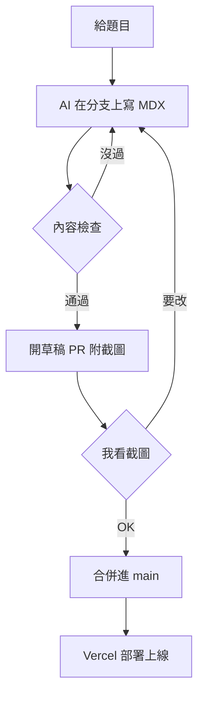

這個網站沒有後台。沒有登入頁、沒有資料庫、沒有編輯器……每一篇文章都是 repo 裡的一個 MDX 檔案，草稿是一個還沒合併的 pull request，按下合併的那一刻就是發布。

會這樣做，是因為我一開始就打算讓 AI 幫我起草文章。這篇說明當初考慮過哪些做法、為什麼最後選了 git，以及這個選擇付出的代價。

## 我考慮過的三條路

要架一個個人技術網站，最常見的選擇有三種：

- **Hashnode**：開發者社群平台，註冊就能寫，文章還會被平台推薦給其他讀者。
- **Ghost**：專業的部落格系統，內建電子報和付費會員。
- **Payload 這類資料庫型 CMS**：自己架後台，內容存在資料庫裡，彈性最大。

這三種都是為「人自己寫」設計的：登入後台、在編輯器裡打字、按下發布。但我的前提不一樣，大部分的文字會由 AI 起草，我只負責看和決定。在這個前提下，後台反而礙事。

## AI 擅長改檔案，審核就是 code review

讓 AI 寫文章，最自然的工作方式不是操作網頁編輯器，而是在一個分支上改檔案，再開一個 pull request。這正好也是工程師每天在做的事。



這樣一來，「審稿」就是 code review：每一次修改都有完整的 diff 和歷史紀錄，看得到 AI 到底改了什麼。也不用另外蓋一套權限系統：AI 只負責開 PR，要等我看過截圖說 OK，才會合併。

還有一個理由是 MDX 本身。MDX 是「Markdown 加上 React 元件」，平常寫起來跟 Markdown 一樣，需要時可以在文章裡嵌一個互動元件。這是之後放 AI Demo 的關鍵，而 Hashnode 和 Ghost 都做不到。

## 規則寫成程式，不靠人記

內容一旦交給 AI，最怕的不是錯字，而是它不守規矩：今天標籤寫 `agent`，明天寫 `ai-agents`；改了網址，舊連結就壞了。所以這個網站把所有規則寫進一個內容模組，每次提交都會自動檢查：

- **標籤只能從核准清單挑。** 清單在 `content/tags.yml`，目前 17 個，全是小寫英文。要新增標籤，得在 PR 裡寫明理由，我合併就等於核准。
- **網址換了，舊網址自動轉過去。** 舊的網址代號記在 `previousSlugs`，永久轉址到新網址。
- **移除的文章回應 410。** 不是一般的 404「找不到」，而是明確告訴瀏覽器和搜尋引擎「這裡曾經有東西，但已經永久拿掉了」。移除過的網址也不能再給新文章用。
- **勘誤和改版分開。** 改錯字不留痕跡；改了讀者會學到的內容，就要記一筆改版紀錄，文章顯示「更新於」。你現在看到的這一版，就是一次改版。

規則沒過，錯誤訊息會指出檔案、欄位和規則，並告訴你怎麼改。例如用了清單外的標籤：

```text
posts/rag-intro/index.mdx: tags: "rag" isn't in the approved Tag list (tags.yml); use an approved Tag, or add it there and give the reason in the PR [approved-tag]
```

AI 寫錯了，就照著這段訊息自己修；我在 GitHub 網頁上手動改錯，CI 也會用同樣的訊息擋下來。每一條規則都有一個「只違反這條規則」的測試範例，目前有 67 個。

## 不用部落格範本

Next.js 有很多現成的部落格範本，第一天就有文章頁、標籤、RSS 和深色模式。我考慮過，最後還是沒用。

原因很簡單：這個網站的價值在上面那些內容規則，而沒有一個範本有這些規則。硬把規則接到範本自己的內容層上，比自己寫一個小小的內容模組還費工。程式碼保持小巧，還有一個附帶的好處，AI 讀得完整個專案。

反過來說，大家都有的功能就不自己寫：sitemap 和分享預覽圖用 Next.js 內建的寫法，RSS 和深色模式切換用現成套件。框架選 Next.js 而不是更輕量的 Astro，是因為我本來就熟，而且之後的 AI Demo 需要在伺服器端呼叫模型、串流回應，Next.js 部署在 Vercel 上就能做到，不用另外架後端。

## 放棄了什麼

每個選擇都有代價，這套做法放棄了：

- **平台的社群流量。** 不在 Hashnode 上，就沒有平台的推薦流量。需要的話，可以手動轉貼，並加上指回原文的 `canonical` 網址。
- **電子報和會員功能。** 這是 Ghost 內建的，這裡沒有。
- **暫時下架和排程發布。** 移除就是永久的；合併當下就上線，文章的日期只是顯示用。

換來的是一個 AI 用起來順手、每次修改都查得到、規則不靠人記的內容系統。這個網站從 2026-11-01 凌晨的第一個 commit 開始，到 2026-11-02 已經合併了 38 個 pull request，每一個都走這套流程。

接下來，我會把互動 AI Demo 放進來。到那時候，MDX 能嵌入元件的這個選擇，才會真正派上用場。
