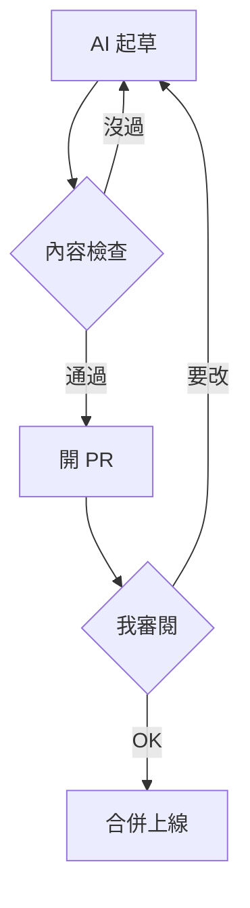

你現在讀的這個版本，是一個 pull request 合併之後的結果。

這篇文章第一版只有短短幾行，我自己回頭看都覺得太單薄，於是請 AI 重寫。它開了一個分支、改了一個檔案、跑完所有檢查，再開一個 pull request 給我看……我讀完說 OK，它按下合併，網站就換上新版，頁面上也自動多了一行「更新於」。

整個過程沒有登入任何後台，也沒有碰到資料庫。這個網站的每一篇文章，都只是 git repo 裡的一個檔案。這篇想說清楚，我為什麼選了這條比較少人走的路，它實際上長什麼樣子，以及我付出了什麼代價。

## 一篇文章，就是一個資料夾

每篇文章是 repo 裡的一個資料夾，資料夾的名稱就是網址的代號。這篇的網址是 `/posts/why-mdx-in-git`，對應的資料夾長這樣：

```bash
content/posts/why-mdx-in-git/
├── index.mdx    # 文章本體
└── cover.jpg    # 封面圖（選填），圖片跟文章放在一起
```

文章檔案的開頭是一小段設定（frontmatter），記錄標題、日期、標籤這些資料，下面才是內文：

```yaml
---
title: 為什麼這個網站的文章寫在 git 裡
description: 沒有後台、沒有資料庫，每篇文章都是一個檔案……
date: 2026-11-01
tags: [meta, architecture]
cover: cover.jpg
revisions:
  - date: 2026-11-02
    note: 擴寫：補上文章的檔案結構、內容檢查、審核流程與這個做法的代價
---
```

文章用的格式是 MDX：就是 Markdown，但可以在裡面放 React 元件。標題、清單、程式碼、表格都照 Markdown 的寫法，這篇裡的流程圖則是一段 Mermaid 文字，網站建置時才畫成圖，而且會跟著深色模式換顏色。

## 為什麼不用現成平台

開工前我比較過 Hashnode、Ghost 這類部落格平台，也看過 Payload 這種自己架資料庫的 CMS。後者還得另外蓋一套審核流程，所以真正的對手是平台：

| | 部落格平台 | MDX 放在 git |
| --- | --- | --- |
| 文章存在哪 | 平台的資料庫 | repo 裡的檔案 |
| AI 怎麼寫 | 透過 API，或手動貼上 | 直接改檔案 |
| 怎麼審核 | 平台的草稿功能 | pull request |
| 版本紀錄 | 留在平台上 | 每個字的 diff，和程式碼放在一起 |
| 互動元件 | 不行或很有限 | 原生支援 |
| 現成的好處 | 社群流量、電子報、會員 | 幾乎沒有 |

右邊那一欄幾乎沒有現成功能，前五列卻都站在我這邊。關鍵在於這個網站有一個前提：**大部分的文字由 AI 起草，但只有我能決定什麼東西上線。** 照這個前提去看，平台的優勢反而用不太上。

## AI 起草，就是在分支上改檔案

對 Claude Code 這類 AI 寫程式工具來說，「改檔案、開 pull request」是它每天都在做的事。文章變成檔案之後，寫文章跟寫程式就走同一條路：

- 不用給 AI 任何平台的 API 金鑰，也不用另外寫串接程式。
- AI 寫文章時，可以直接讀 repo 裡的程式碼、git 紀錄和其他文章。像〈[創世紀](/posts/how-this-site-was-built)〉那篇裡的「72 個 commit、37 個 pull request」，都是 AI 從 git 紀錄查出來的，不是它自己編的數字。
- 寫文章的規則，像我的口氣、標籤怎麼挑、圖片放哪裡，寫成一份 skill 放在 repo 裡，跟程式碼一起受版本控制。

與其說我在經營一個部落格，不如說我在維護一個程式專案，只是其中一部分的程式碼剛好是中文散文。

## 內容也要過 CI

既然文章是程式碼，它就應該像程式碼一樣被檢查。網站有一個內容模組，建置前會把每篇文章讀一遍，任何一條規則沒過，就整個擋下來，並且說清楚是哪個檔案、哪個欄位、違反哪條規則。

我故意把這篇文章改壞來示範：日期寫成 13 月、標籤寫一個不在清單裡的 `blog`、再引用一張不存在的圖片，檢查的結果是：

```bash
$ pnpm content:check
Content is invalid:
  posts/why-mdx-in-git/index.mdx: date: must be a date written YYYY-MM-DD [date-format]
  posts/why-mdx-in-git/index.mdx: tags: "blog" isn't in the approved Tag list (tags.yml); use an approved Tag, or add it there and give the reason in the PR [approved-tag]
  posts/why-mdx-in-git/index.mdx: body: "./missing.png" doesn't exist; referenced images must exist next to the Post, as a path relative to its folder [image-exists]
```

錯誤訊息是寫給 AI 看的：它照著訊息修，不需要我介入。目前這樣的規則有 67 個測試範例，每個範例只違反一條規則，涵蓋了標籤、日期、圖片、流程圖語法、網址歷史和文宣圖設定。

每個 pull request 在 GitHub 上會跑四道關卡：目標分支一定要是主線、程式和內容檢查、用真實文章完整建置一次（連警告都不允許）、最後再跑一輪瀏覽器測試。全部通過，才輪得到我看。機器擋得下來的錯，就不該花到我的注意力。

## 審核，就是 code review

所有變更都走同一條路。檢查沒過，AI 會照錯誤訊息自己修正，再檢查一次：



我不用讀程式碼，AI 會把文章在淺色、深色、手機、桌機四種情況下拍成截圖，排在同一頁給我看。想看細節時，diff 會把每一個改動的字都標出來。

改文章時，這套流程的好處最明顯。網站把改動分成兩種：

- **勘誤**：讀者察覺不到內容有變，例如錯字、斷行。像這篇文章分享到社群時，預覽圖上的標題斷在奇怪的位置，我只改了 3 行設定，讀者看不出任何差別，頁面上也不會出現更新日期。
- **改版**：讀者學到的東西變了，例如你正在讀的這次擴寫。文章開頭的設定會多記一筆改版紀錄，寫明日期和改了什麼，頁面上就會顯示「更新於」。

哪一種、改了哪幾個字、誰改的、什麼時候合併，git 全部記得。在平台上，一篇文章被改過幾次，讀者通常無從得知；在這裡，連我自己都能隨時翻出每一個版本。

## 網址也有歷史

文章檔案化之後，連網址都能被規則管理：

- **改網址**：把資料夾改名，並記下舊的代號，舊網址就會永久轉址到新網址，分享出去的連結不會失效。
- **整篇移除**：刪掉資料夾，把代號加進移除清單，那個網址就會明確回應 410（已移除），而不是讓人以為打錯網址的 404。被移除的代號也不能再被新文章拿去用。

這些規則都寫在內容模組裡，有測試保護。換成平台的話，我只能接受平台幫我決定的行為。

## 我付出的代價

這條路當然不是免費的。

- **沒有社群流量。** Hashnode 和 Medium 自帶讀者，我的網站要自己找人來看。需要的話，可以把文章轉貼到這些平台，並加上指回原文的 `canonical` 網址，搜尋引擎就知道原文在哪。
- **沒有編輯介面。** 我沒辦法在手機上打開後台改一個錯字。每一次修改，再小都是一個 pull request。
- **沒有現成的功能。** 標籤、RSS、轉址、深色模式，都是一行行寫出來的。這些在平台上是開箱即用的東西，在這裡都得自己做。
- **要等建置。** 文章是建置時才產生的靜態頁面，合併之後要等網站重新建置完，新版才會上線，沒辦法按下儲存就馬上生效。

但這些代價，剛好都落在我不在意的地方。我不打算在手機上寫文章，因為起草的是 AI；流量可以之後再經營，但一篇內容出錯的文章掛在個人品牌網站上，傷害的是信用。用一點便利，換整條審核流程都在自己手上，這個取捨我覺得划算。

## 接下來

選 MDX 還有一個理由，我到現在還沒用到：它可以在文章裡直接放 React 元件。

下一步，我要把互動的 AI Demo 做成元件，讓讀者在文章裡就能直接操作，不用跳去另一個網站。到時候，那篇文章一樣會是一個資料夾、一個 pull request，一樣要先過內容檢查，最後由我看截圖說 OK……這套流程，會用同一套規矩，把文字和程式一起管好。
