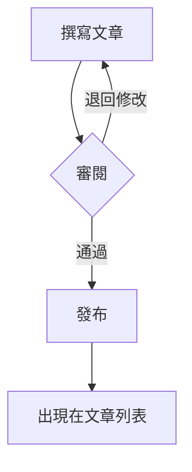
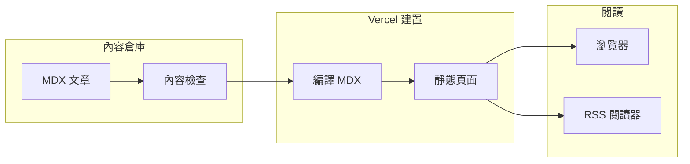

這篇文章集合內文會用到的元素：段落裡有 `inline code`、[一個連結](/posts)和**粗體**。

## 清單

- 第一項
- 第二項有 `code`

1. 有序一
2. 有序二

## 程式碼與引言

> 引言一段，說明某件事。

```ts
// 一段註解
export function greet(name: string): string {
  return `hello, ${name}`;
}
```

```bash
# 沒有特別註明的語言也會上色
pnpm content:check
```

<Callout title="注意">

提示框裡可以放一般內文，例如 `inline code` 和[連結](/posts)。

</Callout>

## 表格

| 風格 | 畫法 | 產圖時間 | 適合 |
| --- | --- | ---: | --- |
| 線稿藍圖 | Claude 寫 SVG | 2 秒 | 流程、架構、`pnpm content:check` 這類指令 |
| 水墨意象 | 本機 Fooocus | 19 秒 | 封面的意境 |

## 圖片

放在文章資料夾裡的圖片：


## 圖表

用 Mermaid 畫的流程圖：



橫向的架構圖，放不進內文欄（或在手機上）時會改成由上往下畫：



### 第三層標題

最後一段，一行很長的文字，用來確認行高與段落間距在兩種主題下都好讀，也確認文字在窄螢幕上會正常換行，不會讓整頁水平捲動。
